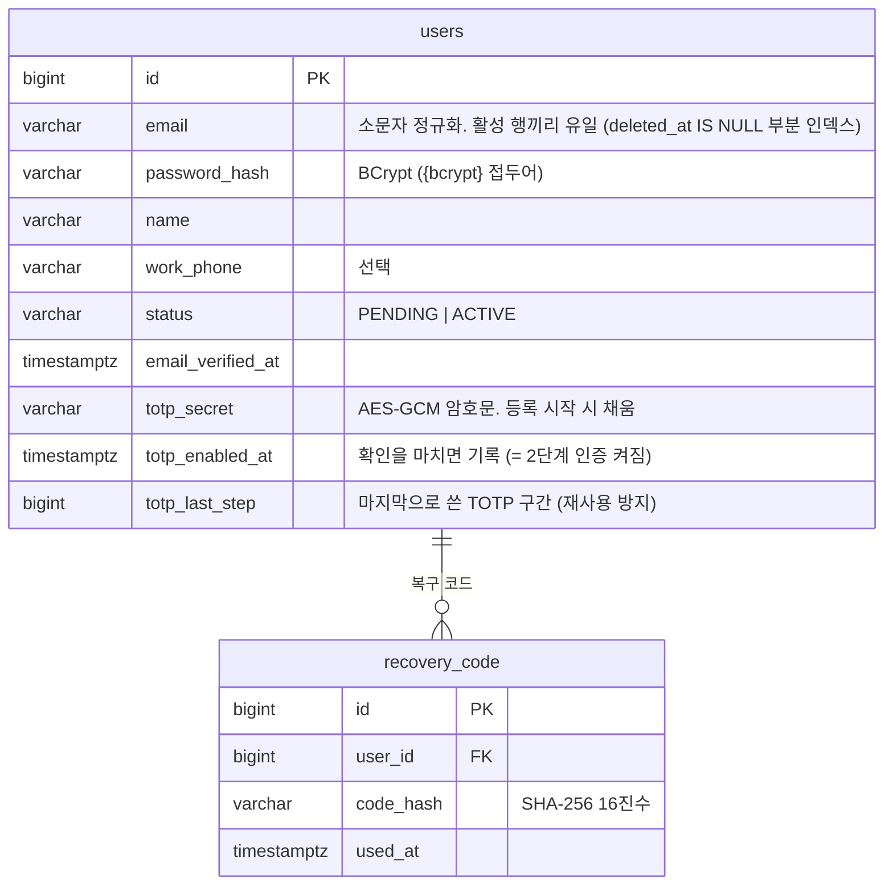

# 재구현 ERD

> Flyway 마이그레이션(`src/main/resources/db/migration`)과 같은 내용을 그린다. 마이그레이션을 추가할 때 함께 고친다.
> 모든 테이블은 감사 필드(`created_at`, `updated_at`, `created_by`, `updated_by`)와 `deleted_at`(soft delete)을 가진다. 아래 그림에서는 생략한다.

## S1 회원·인증 (`V2__users.sql`)

### DB 밖에 두는 상태 (Redis)
| 키 | 내용 | 수명 |
|---|---|---|
| `spring:session:*` | 로그인 세션 (Spring Session). 사용자 id로 색인 | 미사용 14일. 절대 수명 30일은 애플리케이션이 확인 |
| `auth:ott:{용도}:{토큰 해시}` | 메일 링크 토큰 → 사용자 id, 만료 시각 | 이메일 인증 24시간, 비밀번호 재설정 30분 |
| `auth:login-failures:{사용자 id}` | 연속 실패 횟수 | 1일 |
| `auth:login-lock:{사용자 id}` | 잠금 해제 시각 | 15분 |
