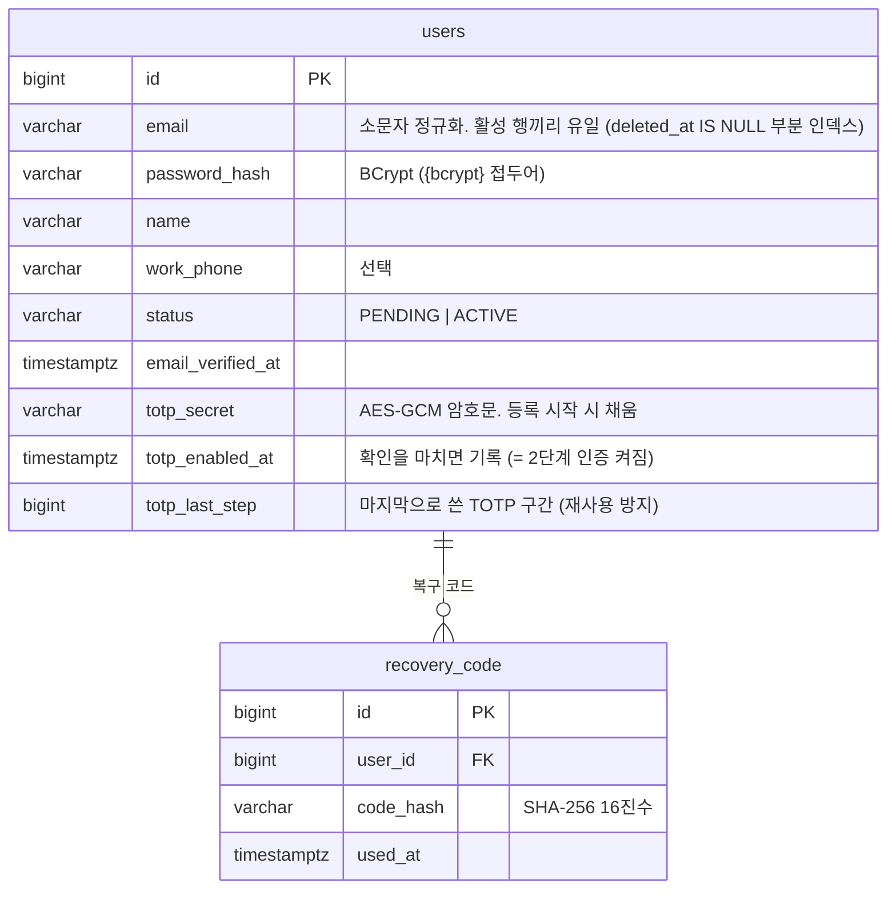
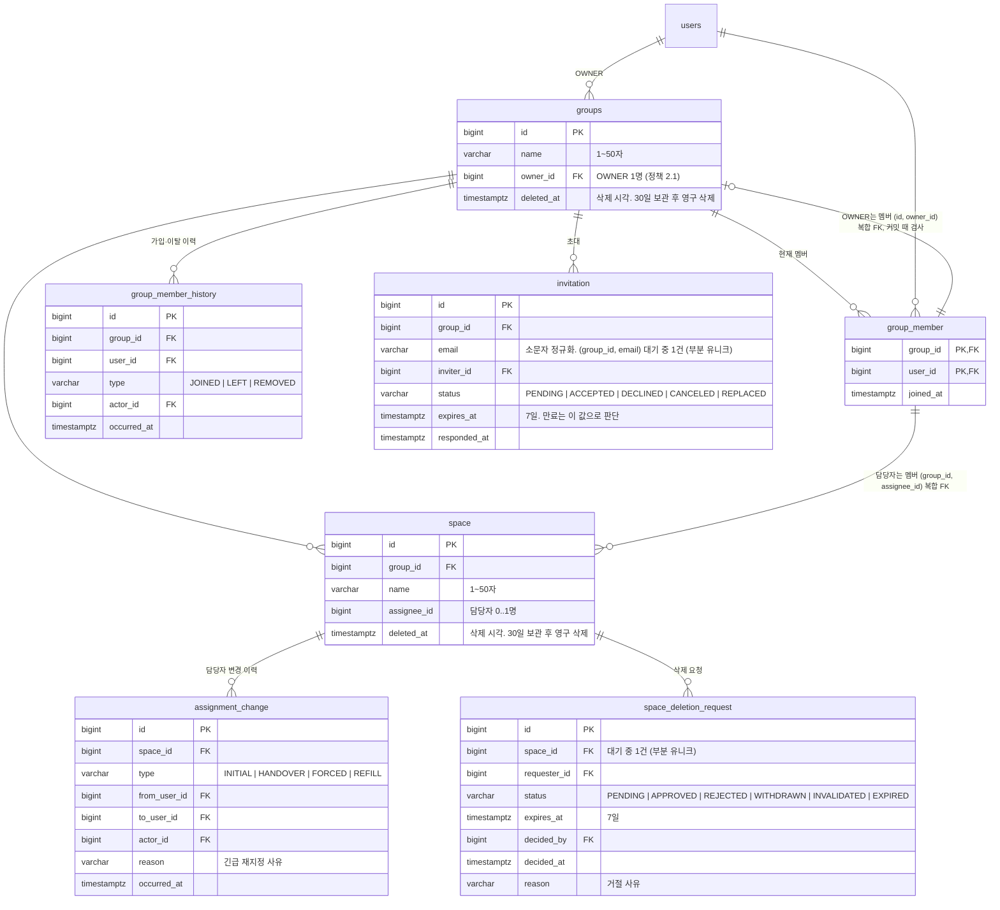

# 재구현 ERD

> Flyway 마이그레이션(`src/main/resources/db/migration`)과 같은 내용을 그린다. 마이그레이션을 추가할 때 함께 고친다.
> 모든 테이블은 감사 필드(`created_at`, `updated_at`, `created_by`, `updated_by`)와 `deleted_at`(soft delete)을 가진다. 아래 그림에서는 생략한다.

## S1 회원·인증 (`V2__users.sql`)

## S2 그룹·스페이스·권한 (`V3__groups_spaces.sql`)

- `group_member`는 soft delete하지 않는다. 감사 필드와 `deleted_at`도 없다 (현재 멤버만 둔다).
- `group_member_history`, `assignment_change`는 추가 전용이다. 트리거 `reject_append_only_modification()`이 UPDATE·DELETE·TRUNCATE를 거부하고, 영구 삭제 트랜잭션(`app.purge = 'on'`)에서만 DELETE·TRUNCATE를 허용한다.
  - 이 두 테이블은 감사 필드와 `deleted_at`이 없다(코드 규약의 예외). 행을 바꿀 수 없으니 수정·삭제 정보가 생길 수 없고, 생성 정보는 `actor_id`·`occurred_at`이 담는다 (`DESIGN_REVIEW.md` 6.5).
- 보관 중인 스페이스에서 담당하던 멤버가 그룹을 떠나면 그 스페이스의 `assignee_id`를 비운다 (복합 FK, 정책 2.6 제4항).

### DB 밖에 두는 상태 (Redis)
| 키 | 내용 | 수명 |
|---|---|---|
| `spring:session:*` | 로그인 세션 (Spring Session). 사용자 id로 색인 | 미사용 14일. 절대 수명 30일은 애플리케이션이 확인 |
| `auth:ott:{용도}:{토큰 해시}` | 메일 링크 토큰 → 사용자 id, 만료 시각 | 이메일 인증 24시간, 비밀번호 재설정 30분 |
| `auth:login-failures:{사용자 id}` | 연속 실패 횟수 | 1일 |
| `auth:login-lock:{사용자 id}` | 잠금 해제 시각 | 15분 |
