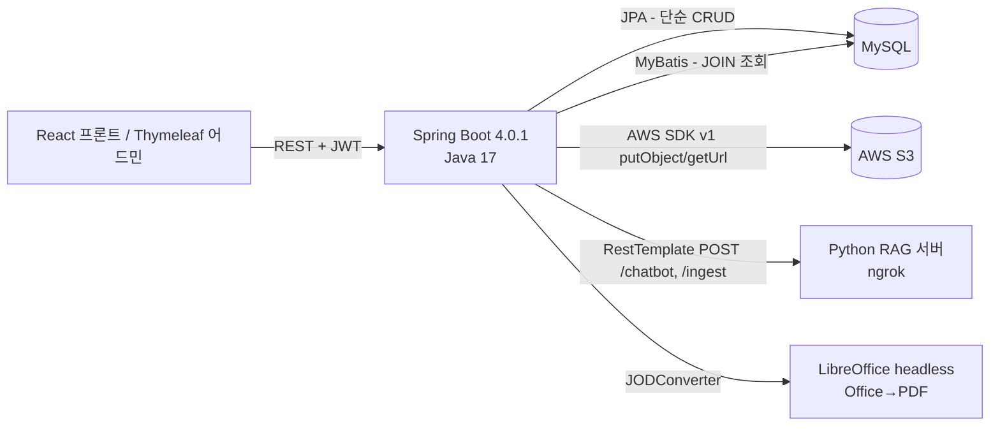
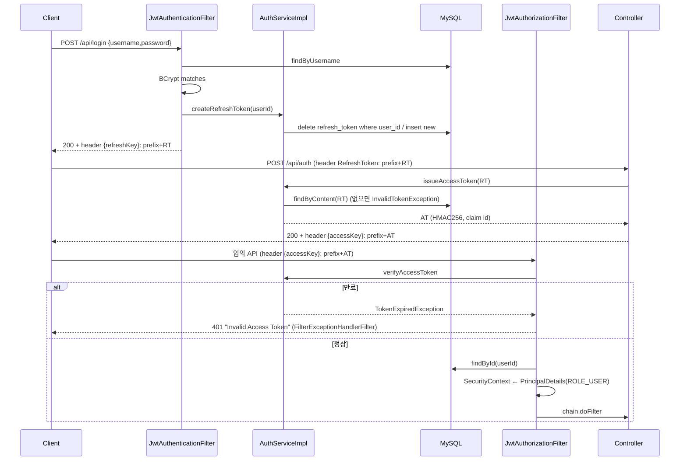
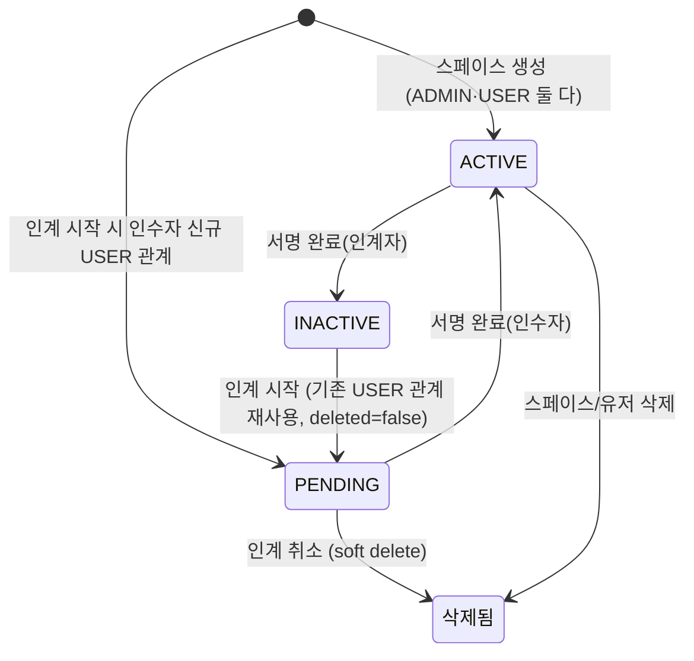
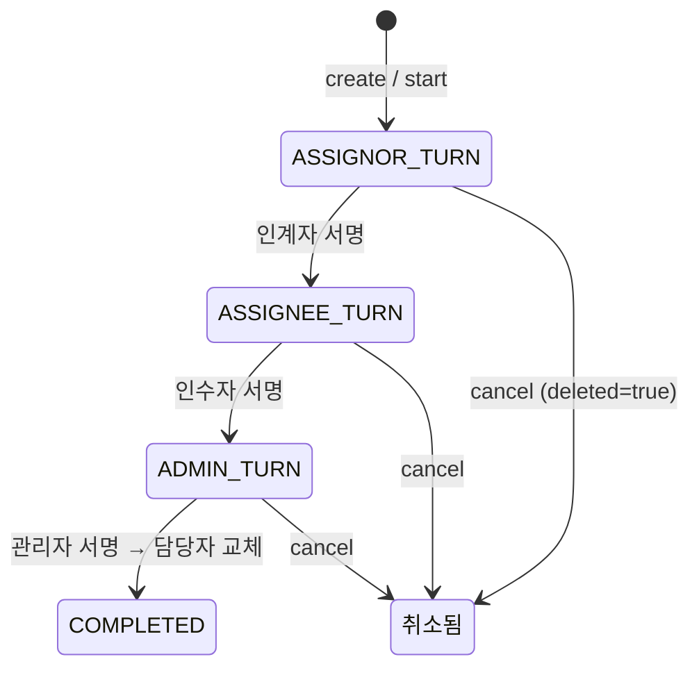
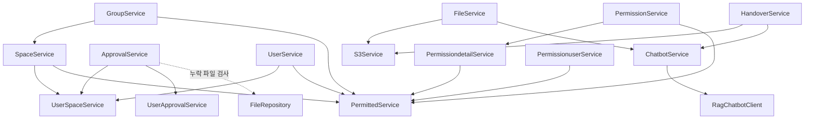

# 인계점(Ingyejeom) 백엔드 역엔지니어링 명세서

> 상태: **v1.0** · 기준 커밋: `d3e84c8` (branch `develop`) · 작성일: 2026-10-27
> 성격: 기존 팀 프로젝트의 **현행(as-is) 동작 기록**. 재구현은 이 문서를 출발점으로 삼아 재설계한다.
> 관련 문서: [`DESIGN_REVIEW.md`](./DESIGN_REVIEW.md) (재설계 검토), [`TEST_SPEC.md`](./TEST_SPEC.md) (목표 동작 테스트 명세)
> 범위 제외: Thymeleaf 템플릿/페이지 컨트롤러(재구현에서 폐기, 프론트는 별도 생성), 운영 환경 설정 값
> 근거 표기: `J/` = `src/main/java/com/thc/capstone/`, `R/` = `src/main/resources/`, `T/` = `src/test/java/com/thc/capstone/`
> 표기 규칙: 모든 주장에 `파일:라인` 근거. 코드로 확인 불가한 사항은 `[미확인]`, 코드로부터 추론한 사항은 `[추론]`.
> 비밀값(DB 비밀번호, JWT 키, AWS 키·버킷, 외부 URL)은 `***` 로 마스킹.

---

## 목차
1. [개요 & 아키텍처](#1-개요--아키텍처)
2. [설정 & 배포](#2-설정--배포)
3. [데이터 모델](#3-데이터-모델)
4. [DTO 계약](#4-dto-계약)
5. [API 명세](#5-api-명세)
6. [보안 & 인증](#6-보안--인증)
7. [도메인별 비즈니스 로직](#7-도메인별-비즈니스-로직)
8. [외부 연동](#8-외부-연동)
9. [예외 & 로깅](#9-예외--로깅)
10. [테스트](#10-테스트)
11. [재구현 가이드](#11-재구현-가이드)
12. [관찰 사항](#12-관찰-사항)
13. [읽은 파일 체크리스트](#13-읽은-파일-체크리스트)
14. [미확인 항목 모음](#14-미확인-항목-모음)

---

## 1. 개요 & 아키텍처

**인계점**은 RAG 챗봇을 활용한 업무 인수인계 플랫폼의 REST API 서버다 (`README.md`, `J/config/SwaggerConfig.java:24-25`).
핵심 개념:

| 개념 | 엔티티 | 설명 |
|---|---|---|
| 그룹 | `Group` (`tb_group`) | 조직 단위. 1개 이상의 스페이스를 가짐 |
| 스페이스 | `Space` | 그룹 내 하나의 "업무". 업무명 + UUID 스페이스 코드 |
| 유저-스페이스 | `UserSpace` | 사용자와 스페이스의 관계. `role`(ADMIN/USER) × `status`(ACTIVE/PENDING/INACTIVE…) |
| 서명(결재) | `Approval` + `UserApproval` | 인계자 → 인수자 → 관리자 3단계 서명. 완료 시 담당자 교체 |
| 인수인계서 | `Handover` | 스페이스 담당자가 작성하는 JSON 모듈 문서 |
| 파일/폴더 | `File`(`tb_file`), `Folder` | S3 저장 파일 + 스페이스 내 트리형 폴더 |
| 챗봇 | `Chatbot` | Python RAG 서버 질의응답 기록 |
| 권한 | `Permission`/`Permissiondetail`/`Permissionuser` | 테이블(target) × 기능(func) 기반 RBAC (부분 사용) |



**계층 구조**: `Controller → Service(interface) → ServiceImpl → {JPA Repository | MyBatis Mapper | S3Service | RagChatbotClient}`.
- 쓰기·단건 조회: JPA Repository
- 목록·JOIN 조회: MyBatis Mapper (목록 쿼리는 `id`만 반환 → 서비스의 `addlist()`가 id마다 `detail` 쿼리 재호출하는 N+1 패턴. 예: `J/service/impl/GroupServiceImpl.java:136-145`)
- 엔티티 간 JPA 연관관계(`@ManyToOne` 등) **없음**. 모든 관계는 `Long xxxId` 컬럼으로만 표현.

**공통 코딩 규약**
- 엔티티: `protected` 기본 생성자 + `private` 전체 생성자 + `static of(...)` 팩토리 + `update(XxxDto.UpdateReqDto)` (null 아닌 필드만 반영) + `toCreateResDto()` (예: `J/domain/Group.java:20-46`)
- DTO: `XxxDto` 내부 static class (`CreateReqDto`, `UpdateReqDto extends DefaultDto.UpdateReqDto`, `DetailResDto extends DefaultDto.DetailResDto`, `ListReqDto extends DefaultDto.ListReqDto`)
- 삭제: 전부 Soft Delete (`deleted=true`), `delete()`는 `update(id, deleted=true)` 위임
- 컨트롤러: `getUserId(PrincipalDetails)` 헬퍼로 요청자 ID 추출 후 서비스에 `reqUserId` 전달

---

## 2. 설정 & 배포

### 2.1 빌드 (`build.gradle`)

| 항목 | 값 | 근거 |
|---|---|---|
| Spring Boot | 4.0.1 | `build.gradle:3` |
| dependency-management | 1.1.7 | `build.gradle:4` |
| Java toolchain | 17 | `build.gradle:13` |
| group / version | `com.thc` / `0.0.1-SNAPSHOT` | `build.gradle:7-8` |
| prod 빌드 | `-Pprod` 시 bootJar 에서 `templates/**` 제외 | `build.gradle:73-77` |

### 2.2 의존성과 실제 사용처

| 라이브러리 | 버전 | 사용 위치 |
|---|---|---|
| spring-boot-starter(-web, -validation, -test) | Boot 관리 | 전역. validation 어노테이션은 **어디에도 사용 안 됨** |
| spring-boot-starter-thymeleaf | Boot 관리 | `J/controller/page/*`, `R/templates/**` |
| spring-boot-starter-restclient | Boot 관리 | `RestTemplateBuilder` 제공 (`J/config/ChatbotHttpConfig.java:30`) |
| spring-boot-starter-data-jpa + mysql-connector-j | Boot 관리 | `J/repository/*` |
| mybatis-spring-boot-starter | 3.0.3 | `J/config/MybatisConfig.java`, `J/mapper/*`, `R/mapper/*.xml` |
| commons-io | 2.13.0 | **미사용** |
| springdoc-openapi-starter-webmvc-ui | 3.0.3 | `J/config/SwaggerConfig.java`, 컨트롤러 `@Operation` |
| commons-codec | 1.5 | `J/util/AES256Cipher.java` (Base64) — 해당 유틸 자체가 미사용 |
| spring-boot-starter-security | Boot 관리 | `J/config/SecurityConfig.java`, `J/security/*` |
| jjwt-api/impl/jackson | 0.11.5 | **미사용** (실제 JWT는 auth0 사용) |
| com.auth0:java-jwt | 4.4.0 | `J/security/AuthServiceImpl.java` |
| spring-cloud-starter-aws | 2.4.4 | `J/config/S3Config.java` (AWS SDK v1 `AmazonS3`) |
| jodconverter-local / -spring-boot-starter | 4.4.7 | `J/controller/FileRestController.java:40,149-155` |
| lombok | Boot 관리 | 전역 |

### 2.3 `application.yaml` 키 전체 (`R/application.yaml`, 87줄, `.gitignore`에 의해 Git 미추적)

| 키 | 값 | 읽는 곳 |
|---|---|---|
| `spring.application.name` | `capstone` | Boot |
| `spring.datasource.url` | `jdbc:mysql://localhost:3306/capstonetest` | Boot DataSource |
| `spring.datasource.username/password` | `root` / `***` | Boot |
| `spring.datasource.driver-class-name` | `com.mysql.cj.jdbc.Driver` | Boot |
| `spring.jpa.defer-datasource-initialization` | `true` | Boot |
| `spring.jpa.hibernate.ddl-auto` | `update` | Hibernate — **스키마는 엔티티로부터 자동 생성** |
| `spring.jpa.show-sql` / `properties.hibernate.format_sql` | `true` / `true` | Hibernate |
| `spring.jpa.properties.hibernate.default_batch_fetch_size` | `100` | Hibernate (연관관계 없어 무의미) |
| `spring.jpa.properties.hibernate.jdbc.time_zone` | `Asia/Seoul` | Hibernate |
| `spring.thymeleaf.cache` / `freemarker.cache` | `false` | Boot |
| `spring.devtools.*` | livereload/restart true | devtools 의존성 **없음** → 무효 |
| `spring.sql.init.mode` | `always` | `schema.sql`/`data.sql` 파일 **없음** → 무효 |
| `spring.web.cors.allowed-origins` | `http://localhost:3000` | 표준 Boot 키 아님 → 무효. 실제 CORS는 `CorsFilterConfiguration` |
| `spring.servlet.multipart.max-file-size/max-request-size` | `200MB` / `200MB` | Boot |
| `springdoc.use-fqn` | `true` | springdoc (스키마명에 FQCN 사용) |
| `external.jwt.tokenSecretKey` | `***` | `J/security/ExternalProperties.java:10` |
| `external.jwt.tokenPrefix` | `***` (예: `"Bearer "` 형태 추정) `[추론]` | `ExternalProperties.java:13` |
| `external.jwt.accessKey` | `***` (Access 토큰 헤더명. CORS 노출 헤더로 보아 `Authorization` `[추론]`) | `ExternalProperties.java:16` |
| `external.jwt.accessTokenExpirationTime` | `***` (ms, `Integer`) | `ExternalProperties.java:19` |
| `external.jwt.refreshKey` | `***` (Refresh 토큰 헤더명. `RefreshToken` `[추론]`) | `ExternalProperties.java:22` |
| `external.jwt.refreshTokenExpirationTime` | `***` (ms, `Integer`) | `ExternalProperties.java:25` |
| `file.dir` | 로컬 경로 | **미사용** (S3 전환 이전 잔재) |
| `chatbot.python.base-url` | `***` (ngrok URL) | `J/config/ChatbotHttpConfig.java:32` |
| `chatbot.python.timeout-ms` | `25000` | `ChatbotHttpConfig.java:33` (기본값 25000) |
| `chatbot.python.default-space-id` | `default` | **미사용** |
| `cloud.aws.s3.bucket` | `***` | `J/service/impl/S3ServiceImpl.java:21` |
| `cloud.aws.region.static` | `ap-northeast-2` | `J/config/S3Config.java:21` |
| `cloud.aws.stack.auto` | `false` | spring-cloud-aws |
| `cloud.aws.credentials.access-key/secret-key` | `***` | `S3Config.java:15,18` |
| `jodconverter.local.enabled` | `***` (반드시 `true` — `DocumentConverter` 빈 주입 필수) `[추론]` | jodconverter starter |

### 2.4 Bean 정의

| Bean | 정의 위치 | 내용 |
|---|---|---|
| `objectMapper` (Jackson 2 `com.fasterxml`) | `J/CapstoneApplication.java:23-26` | `new ObjectMapper()` 수동 등록 (모듈 미등록). 로그인 바디 파싱·챗봇 sources 직렬화에 사용 |
| `pythonRestTemplate` | `J/config/ChatbotHttpConfig.java:29-54` | JDK `HttpClient`(HTTP/1.1, connect 5s) + read timeout=`timeout-ms` + baseUrl `UriBuilderFactory` |
| `corsFilter` | `J/config/CorsFilterConfiguration.java:14-31` | `/**`, origin pattern `*`, credentials true, 모든 메서드/헤더, exposed: `Authorization`, `RefreshToken` |
| `sqlSessionFactory` | `J/config/MybatisConfig.java:16-23` | 매퍼 XML `classpath:/mapper/*.xml`, typeAliasesPackage=`com.thc.sprbasic2025fall.dto`(잘못된 패키지, 영향 없음). `mapUnderscoreToCamelCase` 미설정 → SQL에서 `AS camelCase` 별칭 필수 |
| `@MapperScan("com.thc.capstone.mapper")` | `MybatisConfig.java:14` | |
| `amazonS3Client` | `J/config/S3Config.java:24-35` | `BasicAWSCredentials` + region |
| `passwordEncoder` (`BCryptPasswordEncoder`) | `J/config/SecurityConfig.java:36-39` | |
| `filterChain` | `SecurityConfig.java:44-59` | 6장 참조 |
| `openAPI` | `J/config/SwaggerConfig.java:14-20` | title "인계점", server url `/`. UI: `/swagger-ui/index.html` |
| `@EnableAsync`, `@EnableJpaAuditing` | `J/CapstoneApplication.java:13-14` | 비동기 ingest, `createdAt/modifiedAt` 자동 기록 |

### 2.5 Docker (`Dockerfile`)
1. `FROM eclipse-temurin:17-jdk-jammy`
2. `apt-get install libreoffice-core libreoffice-writer libreoffice-calc libreoffice-impress` (JODConverter용)
3. `COPY build/libs/*SNAPSHOT.jar app.jar`
4. `ENTRYPOINT ["java","-jar","/app.jar"]`

### 2.6 CI/CD (`.github/workflows/deploy.yml`)
트리거: `main` 브랜치 push.
1. checkout → JDK 17 (temurin)
2. `./gradlew clean bootJar -Pprod`
3. DockerHub 로그인 (`secrets.DOCKER_USERNAME/DOCKER_PASSWORD`)
4. `docker build -t $DOCKER_USERNAME/ingyejeom:latest` → push
5. EC2 SSH (`secrets.EC2_HOST/EC2_USERNAME/EC2_SSH_KEY`):
   `docker stop/rm ingyejeom` → `docker pull` → `docker run -d --network host -v /home/ubuntu/application.yaml:/application.yaml --name ingyejeom <image> --spring.config.location=file:/application.yaml`

→ 운영 설정은 EC2의 `/home/ubuntu/application.yaml`이 주입됨 `[미확인: 운영 설정 값]`.

---

## 3. 데이터 모델

### 3.1 공통 상위 클래스 `AuditingFields` (`J/domain/AuditingFields.java:14-37`)

| 필드 | 타입 | 설명 |
|---|---|---|
| `id` | `Long` | `@Id @GeneratedValue(IDENTITY)` |
| `deleted` | `Boolean` | 기본 `false`, `@PrePersist`에서 항상 `false`로 재설정 |
| `createdAt` | `LocalDateTime` | `@CreatedDate` |
| `modifiedAt` | `LocalDateTime` | `@LastModifiedDate` |

명명 전략: Spring 기본(`CamelCaseToUnderscoresNamingStrategy`) → 컬럼은 snake_case (MyBatis SQL이 `created_at`, `user_space_id` 등을 사용하므로 확인됨, 예: `R/mapper/HandoverMapper.xml:15-25`).

### 3.2 엔티티 상세

모든 엔티티는 `AuditingFields` 상속. FK 제약 없음 (논리적 FK만).

**`User` → 테이블 `user`** (`J/domain/User.java`)
| 필드 | 컬럼 | 제약 |
|---|---|---|
| username | username | NOT NULL, UNIQUE (`:16`) |
| password | password | NOT NULL, BCrypt 해시 (`:23`) |
| name | name | |
| email | email | NOT NULL, UNIQUE (`:37`) |
| phone, birth | phone, birth | `String` |
- `update()`: deleted, password, name, email, phone, birth (`:67-86`) — **password를 평문 그대로 세팅**

**`Group` → `tb_group`** (`J/domain/Group.java:12`): `groupName`. `update()`: deleted, groupName.

**`Space` → `space`** (`J/domain/Space.java`): `workName`, `spaceCode`(UUID, 생성 시 서버 발급), `groupId`. `update()`: deleted, workName.

**`UserSpace` → `user_space`** (`J/domain/UserSpace.java`): `role`(`Role`, STRING), `status`(`UserSpaceStatus`, STRING), `userId`, `spaceId`. `update()`: deleted, role, status.

**`Approval` → `approval`** (`J/domain/Approval.java`): `stepStatus`(`StepStatus`, STRING), `spaceId`. `update()`: deleted, stepStatus.

**`UserApproval` → `user_approval`** (`J/domain/UserApproval.java`): `approvalRole`(`ApprovalRole`, STRING), `userId`, `approvalId`, `signedAt`(`LocalDateTime`). `update()`: deleted, signedAt.

**`Handover` → `handover`** (`J/domain/Handover.java`)
| 필드 | 비고 |
|---|---|
| title, role | `String` |
| text | `@Lob @Column(columnDefinition="TEXT")` — 모듈 JSON 문자열 (`:34-36`) |
| userSpaceId | 작성자 UserSpace |
| folderId | null = 루트 |
| pdfGeneratedAt (`LocalDateTime`), pdfGeneratedBy (`Long`) | PDF 생성 기록 |
- `update()`: deleted, title, role, text (`:73-86`). folderId/pdf* 는 setter 직접 사용.

**`Folder` → `folder`** (`J/domain/Folder.java`): `name` NOT NULL, `parentId`(트리), `spaceId` NOT NULL. `update()`: name, deleted.

**`File` → `tb_file`** (`J/domain/File.java`)
| 필드 | 비고 |
|---|---|
| originalFileName | NOT NULL (`:20`) |
| storeFileName | NOT NULL, UNIQUE, `UUID.확장자` (`:27`) |
| fileUrl | S3 객체 URL |
| size | `Long` |
| userSpaceId | 업로드 시점의 UserSpace (setter 없음) |
| folderId | null = 루트 |
| referenceCount | 인수인계서에서 참조된 횟수, 초기값 `0` (`:14,65`) |
- `update()`: deleted, originalFileName.

**`Chatbot` → `chatbot`** (`J/domain/Chatbot.java`): `question` TEXT, `answer` TEXT, `userSpaceId`, `sourcesJson` TEXT (Python 응답 sources 배열 JSON). `toHistoryResDto(ObjectMapper)`가 JSON 역직렬화 (`:58-78`).

**`RefreshToken` → `refresh_token`** (`J/domain/RefreshToken.java`): `userId`, `content`(JWT 문자열).

**`Permission` → `permission`**: `title`, `content`.
**`Permissiondetail` → `permissiondetail`** (`J/domain/Permissiondetail.java:14-27`): `permissionId`, `target`(테이블명), `func`(`Integer`: 110 입력, 120 수정, 200 조회). 인덱스: deleted, permissionId, target, func. UNIQUE `UQ_permissiondetail_permissionId_target_func(permissionId,target,func)`.
**`Permissionuser` → `permissionuser`** (`J/domain/Permissionuser.java:14-26`): `permissionId`, `userId`. 인덱스: deleted, permissionId, userId. UNIQUE `UQ_permissionuser_permissionId_userId`.

### 3.3 Enum

| Enum | 값 | 사용 |
|---|---|---|
| `Role` (`J/domain/Role.java`) | `ADMIN`, `USER` | UserSpace.role. ADMIN = 스페이스 관리자, USER = 스페이스 담당자 |
| `UserSpaceStatus` (`J/domain/UserSpaceStatus.java`) | `ACTIVE`, `INVITED`, `PENDING`, `INACTIVE`, `REJECTED` | `INVITED`, `REJECTED`는 **미사용** |
| `StepStatus` (`J/domain/StepStatus.java`) | `ASSIGNOR_TURN`, `ASSIGNEE_TURN`, `ADMIN_TURN`, `COMPLETED` | Approval 진행 단계 |
| `ApprovalRole` (`J/domain/ApprovalRole.java`) | `ASSIGNOR`(인계자), `ASSIGNEE`(인수자), `ADMIN`(관리자) | UserApproval |

### 3.4 ERD (논리적 관계, DB FK 없음)

> 그림 버전: [`ERD_AS_IS.svg`](./ERD_AS_IS.svg)

```mermaid
erDiagram
    tb_group ||--o{ space : "group_id"
    space ||--o{ user_space : "space_id"
    user ||--o{ user_space : "user_id"
    space ||--o{ approval : "space_id"
    approval ||--|{ user_approval : "approval_id"
    user ||--o{ user_approval : "user_id"
    user_space ||--o{ handover : "user_space_id"
    folder ||--o{ handover : "folder_id (nullable)"
    space ||--o{ folder : "space_id"
    folder ||--o{ folder : "parent_id"
    user_space ||--o{ tb_file : "user_space_id"
    folder ||--o{ tb_file : "folder_id (nullable)"
    user_space ||--o{ chatbot : "user_space_id"
    user ||--o{ refresh_token : "user_id"
    permission ||--o{ permissiondetail : "permission_id"
    permission ||--o{ permissionuser : "permission_id"
    user ||--o{ permissionuser : "user_id"

    user { bigint id PK; varchar username UK; varchar password; varchar name; varchar email UK; varchar phone; varchar birth }
    tb_group { bigint id PK; varchar group_name }
    space { bigint id PK; varchar work_name; varchar space_code; bigint group_id }
    user_space { bigint id PK; enum role; enum status; bigint user_id; bigint space_id }
    approval { bigint id PK; enum step_status; bigint space_id }
    user_approval { bigint id PK; enum approval_role; bigint user_id; bigint approval_id; datetime signed_at }
    handover { bigint id PK; varchar title; varchar role; text text; bigint user_space_id; bigint folder_id; datetime pdf_generated_at; bigint pdf_generated_by }
    folder { bigint id PK; varchar name; bigint parent_id; bigint space_id }
    tb_file { bigint id PK; varchar original_file_name; varchar store_file_name UK; varchar file_url; bigint size; bigint user_space_id; bigint folder_id; bigint reference_count }
    chatbot { bigint id PK; text question; text answer; bigint user_space_id; text sources_json }
    refresh_token { bigint id PK; bigint user_id; varchar content }
    permission { bigint id PK; varchar title; varchar content }
    permissiondetail { bigint id PK; bigint permission_id; varchar target; int func }
    permissionuser { bigint id PK; bigint permission_id; bigint user_id }
```
(모든 테이블 공통: `deleted bit`, `created_at datetime(6)`, `modified_at datetime(6)`)

### 3.5 재현용 MySQL DDL `[추론: Hibernate ddl-auto=update 의 MySQL 8 생성 결과를 추정]`

> 참고용. 재구현은 기존 데이터 이관 없이 새 스키마(Flyway)로 설계한다 → [`DESIGN_REVIEW.md`](./DESIGN_REVIEW.md) 1장·4.1.

```sql
-- 공통 컬럼 매크로: id bigint NOT NULL AUTO_INCREMENT, deleted bit, created_at datetime(6), modified_at datetime(6), PRIMARY KEY(id)

CREATE TABLE user (
  id bigint NOT NULL AUTO_INCREMENT, deleted bit, created_at datetime(6), modified_at datetime(6),
  username varchar(255) NOT NULL, password varchar(255) NOT NULL, name varchar(255),
  email varchar(255) NOT NULL, phone varchar(255), birth varchar(255),
  PRIMARY KEY (id), UNIQUE (username), UNIQUE (email)
);
CREATE TABLE tb_group (
  id bigint NOT NULL AUTO_INCREMENT, deleted bit, created_at datetime(6), modified_at datetime(6),
  group_name varchar(255), PRIMARY KEY (id)
);
CREATE TABLE space (
  id bigint NOT NULL AUTO_INCREMENT, deleted bit, created_at datetime(6), modified_at datetime(6),
  work_name varchar(255), space_code varchar(255), group_id bigint, PRIMARY KEY (id)
);
CREATE TABLE user_space (
  id bigint NOT NULL AUTO_INCREMENT, deleted bit, created_at datetime(6), modified_at datetime(6),
  role enum('ADMIN','USER'), status enum('ACTIVE','INVITED','PENDING','INACTIVE','REJECTED'),
  user_id bigint, space_id bigint, PRIMARY KEY (id)
);
CREATE TABLE approval (
  id bigint NOT NULL AUTO_INCREMENT, deleted bit, created_at datetime(6), modified_at datetime(6),
  step_status enum('ASSIGNOR_TURN','ASSIGNEE_TURN','ADMIN_TURN','COMPLETED'), space_id bigint, PRIMARY KEY (id)
);
CREATE TABLE user_approval (
  id bigint NOT NULL AUTO_INCREMENT, deleted bit, created_at datetime(6), modified_at datetime(6),
  approval_role enum('ASSIGNOR','ASSIGNEE','ADMIN'), user_id bigint, approval_id bigint, signed_at datetime(6),
  PRIMARY KEY (id)
);
CREATE TABLE handover (
  id bigint NOT NULL AUTO_INCREMENT, deleted bit, created_at datetime(6), modified_at datetime(6),
  title varchar(255), role varchar(255), text TEXT, user_space_id bigint, folder_id bigint,
  pdf_generated_at datetime(6), pdf_generated_by bigint, PRIMARY KEY (id)
);
CREATE TABLE folder (
  id bigint NOT NULL AUTO_INCREMENT, deleted bit, created_at datetime(6), modified_at datetime(6),
  name varchar(255) NOT NULL, parent_id bigint, space_id bigint NOT NULL, PRIMARY KEY (id)
);
CREATE TABLE tb_file (
  id bigint NOT NULL AUTO_INCREMENT, deleted bit, created_at datetime(6), modified_at datetime(6),
  original_file_name varchar(255) NOT NULL, store_file_name varchar(255) NOT NULL, file_url varchar(255),
  size bigint, user_space_id bigint, folder_id bigint, reference_count bigint,
  PRIMARY KEY (id), UNIQUE (store_file_name)
);
CREATE TABLE chatbot (
  id bigint NOT NULL AUTO_INCREMENT, deleted bit, created_at datetime(6), modified_at datetime(6),
  question TEXT, answer TEXT, user_space_id bigint, sources_json TEXT, PRIMARY KEY (id)
);
CREATE TABLE refresh_token (
  id bigint NOT NULL AUTO_INCREMENT, deleted bit, created_at datetime(6), modified_at datetime(6),
  user_id bigint, content varchar(255), PRIMARY KEY (id)
);
CREATE TABLE permission (
  id bigint NOT NULL AUTO_INCREMENT, deleted bit, created_at datetime(6), modified_at datetime(6),
  title varchar(255), content varchar(255), PRIMARY KEY (id)
);
CREATE TABLE permissiondetail (
  id bigint NOT NULL AUTO_INCREMENT, deleted bit, created_at datetime(6), modified_at datetime(6),
  permission_id bigint, target varchar(255), func integer, PRIMARY KEY (id),
  CONSTRAINT UQ_permissiondetail_permissionId_target_func UNIQUE (permission_id, target, func),
  INDEX (deleted), INDEX (permission_id), INDEX (target), INDEX (func)
);
CREATE TABLE permissionuser (
  id bigint NOT NULL AUTO_INCREMENT, deleted bit, created_at datetime(6), modified_at datetime(6),
  permission_id bigint, user_id bigint, PRIMARY KEY (id),
  CONSTRAINT UQ_permissionuser_permissionId_userId UNIQUE (permission_id, user_id),
  INDEX (deleted), INDEX (permission_id), INDEX (user_id)
);
```

### 3.6 JPA Repository 커스텀 메서드

| Repository | 메서드 | 사용처 |
|---|---|---|
| `UserRepository` | `User findByUsername(String)` / `Optional<User> findByEmail(String)` | 로그인·가입 / 인계 시작·스페이스 생성 |
| `SpaceRepository` | `findBySpaceCode`(주석 처리된 join에서만), `findByGroupId` | 그룹 삭제 |
| `UserSpaceRepository` | `findByUserIdAndSpaceIdAndRole` | 인계 생성 시 기존 USER 관계 조회 |
| | `findAllBySpaceIdAndRoleAndStatus` | 미사용(주석 코드) |
| | `findFirstByUserIdAndSpaceIdAndRoleAndStatus` | 파일·챗봇·인수인계 권한 확인 |
| | `findFirstByUserIdAndSpaceIdAndStatusInAndRoleInAndDeleted` | `SpaceSecurityChecker` |
| | `findFirstByUserIdAndSpaceId` | PDF 저장 |
| | `findAllByUserId` / `findAllBySpaceId` | 연쇄 Soft Delete |
| `ApprovalRepository` | (기본) | |
| `UserApprovalRepository` | `findAllByApprovalId`, `findByApprovalIdAndApprovalRole` | 취소·서명 |
| `HandoverRepository` | `findByUserSpaceId`, `findByUserSpaceIdAndDeleted`, `findByRole`, `findByRoleAndDeleted`, `findByUserSpaceIdAndRole`, `findByTitleContaining`, `findByTitleContainingAndDeleted`, `existsByUserSpaceId`, `existsByUserSpaceIdAndRole` | **모두 미사용** |
| | `existsByUserSpaceIdAndDeletedFalse` | 1인 1문서 검사 |
| | `@Lock(PESSIMISTIC_WRITE) findWithLockById` (`J/repository/HandoverRepository.java:46-48`) | PDF 저장 동시성 제어 |
| `FileRepository` | `findAllByUserSpaceId` | 누락파일 검사·참조 카운트 |
| `FolderRepository`, `GroupRepository`, `PermissionRepository` | (기본) | |
| `PermissiondetailRepository` | `findByPermissionIdAndTargetAndFunc` | toggle/create |
| `PermissionuserRepository` | `findByPermissionIdAndUserId` | create |
| `RefreshTokenRepository` | `findByContent`, `findByUserId` | 토큰 검증·폐기 |
| `ChatbotRepository` | `findByUserSpaceIdOrderByCreatedAtAsc`(미사용), `findByUserSpaceIdOrderByIdDesc(id, Pageable)`, `findByUserSpaceIdAndIdLessThanOrderByIdDesc(id, cursor, Pageable)` | 대화 기록 커서 페이징 |

### 3.7 MyBatis 매퍼 ↔ XML 매핑 & SQL

> 결과 매핑은 모두 `resultType` + 컬럼 별칭(`AS camelCase`). `resultMap` 미사용.

**ApprovalMapper** (`R/mapper/ApprovalMapper.xml`)
| 메서드 | 요약 SQL |
|---|---|
| `detail(id)` `:4-26` | `approval LEFT JOIN user_approval(deleted=false)` 후 `GROUP BY approval.id`, `MAX(CASE WHEN approval_role='X' THEN user_id/signed_at END)` 로 assignorId/assigneeId/adminId 및 각 signedAt 피벗 |
| `findAssignorIdBySpaceId(spaceId)` `:29-37` | `user_space` 에서 `role='USER' AND status='ACTIVE' AND deleted=false LIMIT 1` 의 user_id |
| `findAdminIdBySpaceId(spaceId)` `:39-47` | 동일, `role='ADMIN'` |
| `hasRoleByApprovalIdAndUserId(approvalId, reqUserId, requiredRole)` `:50-57` | `COUNT(id)>0 FROM user_approval WHERE approval_id, user_id, approval_role, deleted=false` |
| `findUserSpaceIdByStatus(spaceId, status)` `:60-68` | `user_space.id WHERE role='USER' AND status=#{status} AND deleted=false LIMIT 1` |
| `isHandoverInProgress(spaceId)` `:71-77` | `COUNT(id)>0 FROM approval WHERE space_id AND step_status!='COMPLETED' AND deleted=false` |
| `list(param)` `:86-91` | `SELECT id FROM approval` + commonWhere(deleted, `step_status LIKE %x%`) |

**FileMapper.listItems(spaceId, folderId)** (`R/mapper/FileMapper.xml:5-48`)
```sql
SELECT id, created_at createdAt, 'FOLDER' type, name, NULL fileUrl, NULL size, NULL uploaderName
FROM folder WHERE space_id=#{spaceId} AND deleted=false AND parent_id {IS NULL | = #{folderId}}
UNION ALL
SELECT f.id, f.created_at, 'FILE', f.original_file_name, f.file_url, f.size, u.name
FROM tb_file f JOIN user_space us ON f.user_space_id=us.id JOIN user u ON us.user_id=u.id
WHERE us.space_id=#{spaceId} AND f.deleted=false AND us.deleted=false AND f.folder_id {IS NULL | = #{folderId}}
ORDER BY type DESC, createdAt DESC     -- 폴더 먼저, 최신순
```

**GroupMapper** (`R/mapper/GroupMapper.xml`)
- `detail(id)` `:4-14`: id, deleted, createdAt, modifiedAt, groupName
- commonWhere `:17-24`: deleted, `group_name LIKE`, **`user_space.status`, `user_space.role`** 조건 포함
- `list(param)` `:26-31`: `SELECT tb_group.id FROM tb_group` + commonWhere (user_space 조인 없음 → 12장 B-6)
- `scrollList(param)` `:33-53`: `SELECT DISTINCT tb_group.id FROM tb_group JOIN space JOIN user_space` + commonWhere + `space.deleted=false AND user_space.user_id=#{reqUserId}` + 커서(`desc: #{cursor} > id` / `asc: id > #{cursor}`) + `ORDER BY tb_group.id [DESC|ASC] LIMIT 0, #{perPage}`

**HandoverMapper** (`R/mapper/HandoverMapper.xml`)
| 메서드 | 요약 |
|---|---|
| `detail(id)` `:10-37` | `handover LEFT JOIN user_space LEFT JOIN space LEFT JOIN tb_group LEFT JOIN user` → DetailResDto 전 필드 (deleted 필터 없음) |
| `listBySpaceId(spaceId)` `:43-64` | `INNER JOIN user_space` `WHERE us.space_id=? AND h.deleted=false AND h.folder_id IS NULL ORDER BY created_at DESC` |
| `listBySpaceIdAndFolderId` `:69-90` | 위와 동일, `h.folder_id=#{param2}` |
| `findByUserSpaceId(userSpaceId)` `:97-127` | detail과 동일 컬럼, `deleted=false ORDER BY created_at DESC LIMIT 1` |
| `policyByHandoverId(handoverId)` `:129-156` | handover + 작성자 user_space + **해당 스페이스의 진행 중(미완료·미삭제) approval** + user_approval 피벗(assignorId, assigneeId). `ORDER BY ap.id DESC LIMIT 1` |
| `policyBySpaceId(spaceId)` `:158-176` | 스페이스의 진행 중 approval + 피벗. 없으면 null |
| `findHandoverFolderId(spaceId)` `:178-187` | `folder WHERE space_id AND parent_id IS NULL AND name='인수인계서' AND deleted=false ORDER BY id DESC LIMIT 1` |

**PermissionMapper** (`R/mapper/PermissionMapper.xml`)
- `access(userId)` `:5-16`: 사용자가 `func='200'`(조회) 권한을 가진 target 목록 (3테이블 조인, 모두 deleted=false, `GROUP BY target`)
- `isPermitted({userId,target,func})` `:18-29`: 동일 조인의 count
- `detail(id)` `:33-42`: **`${id}` 문자열 치환**
- `list(param)` `:51-55`: deleted, `title LIKE`

**PermissiondetailMapper** (`R/mapper/PermissiondetailMapper.xml`)
- `detail` `:7-16` (`${id}` 치환, **permission_id 컬럼 미조회**), `list` `:27-31` (deleted, permissionId, target, func)
- `pagedList` `:33-43`: 인터페이스에 없는 **데드 SQL**

**PermissionuserMapper** (`R/mapper/PermissionuserMapper.xml`)
- `detail` `:7-19`: `permissionuser, user` 암시적 조인, `${id}` 치환, `user.username AS userUsername`
- `list` `:29-33`: deleted, permissionId, userId

**SpaceMapper** (`R/mapper/SpaceMapper.xml`)
- `detail(id)` `:4-25`: space + `tb_group.group_name` + 서브쿼리 `currentApprovalId`(진행 중 approval id)
- `list` `:34-39`: deleted, `work_name LIKE`

**UserApprovalMapper** (`R/mapper/UserApprovalMapper.xml`): `detail` (**signed_at 미조회**), `list`(deleted)

**UserMapper** (`R/mapper/UserMapper.xml`)
- `detail(id)` `:4-18`: id, deleted, createdAt, modifiedAt, username, name, email, phone, birth
- `list` `:29-35`: `WHERE user.id is not null` + `<include commonWhere>`(이 또한 `WHERE ...`로 시작) → **WHERE 중복 SQL 오류** (12장 B-5)

**UserSpaceMapper** (`R/mapper/UserSpaceMapper.xml`)
- `detail(id)` `:4-49`: user_space + space(workName, spaceCode) + tb_group(groupName, groupId) + 서브쿼리 `adminName`(ACTIVE ADMIN 이름), `userName`(ACTIVE USER 이름), `ongoingApprovalId`(진행 중 approval)
- commonWhere `:52-61`: deleted, **`user_id=#{reqUserId}` 필수**, status 지정 시 `=status` / 미지정 시 `IN ('ACTIVE','PENDING')`, role, `space.group_id`
- `list` `:63-72`, `pagedList` `:74-89`(`ORDER BY id [ASC|DESC] LIMIT #{calculatedOffset}, #{perPage}`), `listCount` `:91-100`, `scrollList` `:102-122`(커서)
- `isGroupAdmin({userId,groupId})` `:126-133`: `user_space JOIN space WHERE user_id AND group_id AND role='ADMIN'` (deleted/status 미검사)
- `isSpaceActive({userId,spaceId})` `:135-141`: `user_space WHERE user_id AND space_id AND status='ACTIVE'` (role/deleted 미검사)

**파라미터 바인딩**: 다중 파라미터 메서드(`hasRoleByApprovalIdAndUserId`, `findUserSpaceIdByStatus`)는 `@Param` 없이 이름 참조 → Spring Boot Gradle 플러그인의 `-parameters` 컴파일 옵션 + MyBatis `useActualParamName=true`(기본)에 의존 `[추론]`.

---

## 4. DTO 계약

### 4.1 `DefaultDto` (`J/dto/DefaultDto.java`) — 모든 클래스 `@Getter @Setter @NoArgsConstructor @AllArgsConstructor @SuperBuilder` (PagedListResDto 제외)

| 클래스 | 필드 |
|---|---|
| `CreateResDto` | `Long id` |
| `UpdateReqDto` | `Long id`, `Boolean deleted` |
| `DetailReqDto` | `Long id` |
| `DetailResDto` | `Long id`, `Boolean deleted`, `LocalDateTime createdAt`, `LocalDateTime modifiedAt` |
| `ListReqDto` | `Boolean deleted` |
| `PagedListReqDto` | `callPage=1`, `perPage=10`(`@Builder.Default`), `orderBy`, `orderWay`, `deleted`; `getCalculatedOffset() = max(2,perPage) * (max(1,callPage)-1)` (`:52-56`) |
| `PagedListResDto<T>` (`@Getter @Builder`) | `callPage`, `totalPage`, `listCount`, `list`; `of(req, count, list)`: size=max(2,perPage), totalPage=max(1,ceil(count/size)), callPage=min(page,totalPage) (`:67-82`) |
| `ScrollListReqDto` | `perPage=10`, `Long cursor`, `orderWay`, `deleted` |

### 4.2 도메인 DTO

| DTO | 내부 클래스 | 필드 (상속 필드 제외) | 비고 |
|---|---|---|---|
| **UserDto** | `LoginReqDto` | username, password | |
| | `CreateReqDto` | username, password, name, email, phone, birth | `toEntity()` |
| | `UpdateReqDto` ⊂Default | password, name, email, phone, birth | |
| | `DetailResDto` ⊂Default | username, name, email, phone, birth | |
| | `ListReqDto` ⊂Default | name | |
| **GroupDto** | `CreateReqDto` (`@SuperBuilder` 없음) | groupName, `List<SpaceInfo> spaces` | `SpaceInfo{workName, userEmail}` |
| | `UpdateReqDto` ⊂Default | groupName | |
| | `DetailResDto` ⊂Default | groupName | |
| | `ListReqDto` ⊂Default | groupName | |
| | `ScrollListReqDto` ⊂Default.Scroll | reqUserId(hidden), status, role(hidden), groupName | |
| **SpaceDto** | `CreateReqDto` | workName, spaceCode(무시됨), groupId, userEmail | |
| | `UpdateReqDto` ⊂Default | workName | |
| | `DetailResDto` ⊂Default | workName, spaceCode, groupName, currentApprovalId | |
| | `ListReqDto` ⊂Default | workName | |
| **UserSpaceDto** | `JoinReqDto` | spaceCode | 사용처(join) 주석 처리 |
| | `InviteReqDto` | email, spaceId | 미사용 |
| | `CreateReqDto` | role, status, userId, spaceId | |
| | `UpdateReqDto` ⊂Default | role, status | |
| | `DetailResDto` ⊂Default | role, status, userId, spaceId, groupId, groupName, userName, adminName, workName, spaceCode, ongoingApprovalId | |
| | `ListReqDto`/`PagedListReqDto`/`ScrollListReqDto` | reqUserId(hidden), status, role(hidden), groupId | |
| **ApprovalDto** | `InviteReqDto` | email, spaceId | `/start` 요청 |
| | `CreateReqDto` | spaceId, assigneeId | `toEntity()` → `ASSIGNOR_TURN` |
| | `UpdateReqDto` ⊂Default | stepStatus | |
| | `DetailResDto` ⊂Default | stepStatus, spaceId, assignorId, assigneeId, adminId, assignorSignedAt, assigneeSignedAt, adminSignedAt | |
| | `ListReqDto` ⊂Default | stepStatus | |
| **UserApprovalDto** | `CreateReqDto` | approvalRole, userId, approvalId | |
| | `UpdateReqDto` ⊂Default | signedAt | |
| | `DetailResDto` ⊂Default | approvalRole, userId, approvalId, signedAt | |
| | `ListReqDto` ⊂Default | (없음) | |
| **HandoverDto** | `CreateReqDto` | title, role, text, userSpaceId, `List<Long> referencedFileIds` | |
| | `CreateBySpaceIdReqDto` | title, role, text, spaceId, referencedFileIds | |
| | `CreateResDto` ⊂Default.Create | title, role | 미사용 |
| | `UpdateReqDto` ⊂Default | title, role, text, **spaceId(필수)**, referencedFileIds | |
| | `DetailResDto` ⊂Default | title, role, text, userSpaceId, spaceId, folderId, workName, groupId, groupName, userId, userName, userSpaceStatus, pdfGeneratedAt, pdfGeneratedBy | |
| | `PolicyResDto` | handoverId, spaceId, ownerUserId, ownerUserSpaceStatus, activeApprovalId, activeApprovalStepStatus, assignorId, assigneeId, pdfGeneratedAt, pdfGeneratedBy, canEdit, canGeneratePdf, lockReason | |
| | `MoveReqDto` | id, targetFolderId | |
| | `SaveReqDto` | `MultipartFile pdfFile`, `MultipartFile mdFile`, handoverId, spaceId, folderId | |
| **FileDto** | `UploadReqDto` | spaceId, folderId, `List<MultipartFile> files` | |
| | `FileUpdateReqDto` ⊂Default | originalFileName | |
| | `ListReqDto` ⊂Default | spaceId, folderId | |
| | `ItemResDto` ⊂Default.Detail | type(`FOLDER`/`FILE`), name, fileUrl, size, uploaderName | |
| | `FileResourceDto` | `Resource resource`, originalFileName | 내부용 |
| | `CreateFolderReqDto` | spaceId, parentId, name | |
| | `MoveReqDto` | id, type(`FILE`/`FOLDER`, 대문자), targetFolderId | |
| | `FolderUpdateReqDto` ⊂Default | name | |
| **ChatbotDto** | `ChatReqDto` | question, spaceId | |
| | `ChatResDto` | answer, `List<SourceInfoDto> sources` | |
| | `SourceInfoDto` | source, `Integer page` | |
| | `IngestReqDto` | spaceId, `byte[] fileBytes`, fileName | 내부용 |
| | `HistoryResDto` | id, question, answer, `String createdAt`, sources | |
| | `HistoryReqDto` | spaceId, cursor, size(기본 4) | |
| **PermissionDto** | `targets` (static) | `{{"permission","권한"},{"user","사용자"},{"space","업무"},{"group","소속"}}` | |
| | `IsPermittedReqDto` | userId, target, func | |
| | `CreateReqDto` / `UpdateReqDto` | title, content | |
| | `DetailResDto` ⊂Default | title, content, `details`, `targets` | |
| | `ListReqDto` ⊂Default | title | |
| **PermissiondetailDto** | `ToggleReqDto` | permissionId, target, `Integer func`, `Boolean flag` | |
| | `CreateReqDto` | permissionId, target, `Integer func` | |
| | `UpdateReqDto`/`DetailResDto`/`ListReqDto` | permissionId, target, **`Long func`** | 타입 불일치 |
| **PermissionuserDto** | `CreateReqDto` | permissionId, userId, userUsername | userId 없으면 username으로 조회 |
| | `DetailResDto` ⊂Default | permissionId, userId, userUsername, userNick(항상 null) | |

---

## 5. API 명세

### 5.0 공통
- 인증 헤더: `{external.jwt.accessKey}: {tokenPrefix}{accessToken}` (6장)
- 성공 응답: `200 OK` (바디 없음 또는 JSON)
- 오류 응답: `{"message": "..."}` + 상태 (9장). 메서드 보안 실패: `403 {"message": "...", "error":"ACCESS_DENIED"}`
- GET 파라미터 DTO는 쿼리스트링 바인딩 (`@ModelAttribute` 생략형)
- `#param.spaceId` 기반 `isMember` 는 **ACTIVE/PENDING 상태의 ADMIN/USER 관계** 를 검사 (6.4)

### 5.1 인증

**[POST] /api/login** (`JwtAuthenticationFilter`, `J/config/SecurityConfig.java:74`)
- 권한: 없음
- 요청 바디: `{"username": "...", "password": "..."}`
- 처리: `PrincipalDetailsService.loadUserByUsername` → BCrypt 비교 → `authService.createRefreshToken(userId)` (기존 RT 전부 삭제 후 신규 저장)
- 응답: `200`, 바디 없음, 헤더 `{refreshKey}: {prefix}{refreshToken}` (`J/security/JwtAuthenticationFilter.java:62-72`)
- 실패: Spring Security 기본 `unsuccessfulAuthentication` → `401` `[추론]`

**[POST] /api/auth** (`J/controller/AuthRestController.java:21-32`)
- 요청 헤더: `RefreshToken: {prefix}{refreshToken}` (헤더명 하드코딩)
- 처리: `issueAccessToken` → RT가 DB에 존재 + 서명/만료 검증 → AT 생성
- 응답: `200`, 헤더 `{accessKey}: {prefix}{accessToken}`. RT 헤더 누락 시 `{prefix}null` 반환

### 5.2 사용자 `/api/user` (`J/controller/UserRestController.java`)

| Method | URL | 권한 | 요청 | 처리 | 응답 |
|---|---|---|---|---|---|
| POST | `/api/user` | `permitAll()` | Body `UserDto.CreateReqDto` | username 중복 검사 → BCrypt → save | `CreateResDto` |
| PUT | `/api/user` | `hasRole('USER')` | Body `UserDto.UpdateReqDto` | `id==0`이면 본인. 타인이면 `isPermitted(user,120)` **결과 무시** | – |
| DELETE | `/api/user` | `hasRole('USER')` | Body `{id?}` | id 없거나 0 → 본인. soft delete + 해당 유저 UserSpace 전체 soft delete | – |
| GET | `/api/user` | `hasRole('USER')` | Query `id?` | 미지정 시 본인. `UserMapper.detail` | `UserDto.DetailResDto` |
| GET | `/api/user/list` | `hasRole('USER')` | Query `deleted, name` | `UserMapper.list` → `addlist` | `List<DetailResDto>` (현재 SQL 오류) |

### 5.3 그룹 `/api/group` (`J/controller/GroupRestController.java`)

| Method | URL | 권한 | 요청 | 처리 | 응답 |
|---|---|---|---|---|---|
| POST | `/api/group` | **없음** (서비스에서 로그인 검사) | Body `{groupName, spaces:[{workName,userEmail}]}` | spaces 1개 이상 검사 → Group 저장 → 각 SpaceInfo로 `SpaceService.create` | `CreateResDto` |
| PUT | `/api/group` | `@groupSecurityChecker.isGroupAdmin(#param.id)` | Body `{id, groupName}` | 서비스에서도 isGroupAdmin 재검사, 아니면 `permitted(group,120)` | – |
| DELETE | `/api/group` | 동일 | Body `{id}` | 그룹의 모든 Space `SpaceService.delete` → 그룹 soft delete | – |
| GET | `/api/group` | 없음 | Query `id` | `GroupMapper.detail` | `GroupDto.DetailResDto` |
| GET | `/api/group/list` | 없음 | Query `deleted, groupName` | `GroupMapper.list` | (현재 오류, B-6) |
| GET | `/api/group/getProfileGroups` | 없음 (reqUserId null 시 빈 결과) | Query `cursor, perPage, orderWay, groupName` | 서버 강제: `reqUserId=본인, deleted=false, status=ACTIVE, role=ADMIN` → `scrollList` | `List<DetailResDto>` |

### 5.4 스페이스 `/api/space` (`J/controller/SpaceRestController.java`)

| Method | URL | 권한 | 요청 | 처리 | 응답 |
|---|---|---|---|---|---|
| POST | `/api/space` | `hasRole('USER')` | Body `{workName, groupId, userEmail?}` | 그룹 존재 확인 → UUID 코드로 Space 저장 → 요청자 `ADMIN/ACTIVE` UserSpace → `userEmail` 유저(없으면 요청자) `USER/ACTIVE` UserSpace | `CreateResDto` |
| PUT | `/api/space` | `hasRole('USER')` | Body `{id, workName}` | 인계 진행 중이면 `HandoverInProgressException` → `isSpaceActive` 아니면 `permitted(space,120)` | – |
| DELETE | `/api/space` | `hasRole('USER')` | Body `{id}` | update(deleted=true) → 스페이스의 UserSpace 전체 soft delete | – |
| GET | `/api/space` | `permitAll()` | Query `id` | `SpaceMapper.detail` | `SpaceDto.DetailResDto` |
| GET | `/api/space/list` | `hasRole('USER')` | Query `deleted, workName` | `SpaceMapper.list` | `List<DetailResDto>` (전체 스페이스) |

### 5.5 유저-스페이스 `/api/userSpace` (`J/controller/UserSpaceRestController.java`)

| Method | URL | 권한 | 요청 | 처리 | 응답 |
|---|---|---|---|---|---|
| POST | `/api/userSpace` | **없음** | Body `{role, status, userId, spaceId}` | 그대로 저장 | `CreateResDto` |
| PUT | `/api/userSpace` | **없음** | Body `{id, role?, status?, deleted?}` | 그대로 반영 | – |
| DELETE | `/api/userSpace` | `hasRole('USER')` | Body `{id}` | soft delete | – |
| GET | `/api/userSpace` | `hasRole('USER')` | Query `id` | `UserSpaceMapper.detail` | `UserSpaceDto.DetailResDto` |
| GET | `/api/userSpace/list` | `hasRole('USER')` | Query `status, groupId, deleted` | reqUserId 미세팅 → `user_id = NULL` 조건으로 항상 빈 목록 | `List` |
| GET | `/api/userSpace/getProfileSpaces` | `hasRole('USER')` | Query `status?, groupId?, cursor, perPage, orderWay` | 강제: reqUserId, deleted=false, status 없으면 role=USER | `List` |
| GET | `/api/userSpace/getDashboardSpaces` | `hasRole('USER')` | Query `callPage, orderWay, status?, groupId?` | 강제: reqUserId, deleted=false, role=USER, **perPage=7** → `pagedList` | `PagedListResDto<DetailResDto>` |
| GET | `/api/userSpace/getAdminSpaces` | `hasRole('USER') and @groupSecurityChecker.isGroupAdmin(#param.groupId)` | Query `groupId, cursor, perPage, orderWay` | 강제: reqUserId, deleted=false, ACTIVE, ADMIN | `List` |
| (주석) | `/api/userSpace/join` | – | – | 코드 주석 처리 (`:30-38`) — 템플릿 `space/join.html:53`은 여전히 호출 | – |

### 5.6 서명(결재) `/api/approval` (`J/controller/ApprovalRestController.java`)

| Method | URL | 권한 | 요청 | 처리 | 응답 |
|---|---|---|---|---|---|
| POST | `/api/approval/start` | `@spaceSecurityChecker.isMember(#param.spaceId)` | Body `{email, spaceId}` | email → 인수자 조회 → `create(spaceId, assigneeId)` | – |
| POST | `/api/approval` | `hasRole('USER') and isMember(#param.spaceId)` | Body `{spaceId, assigneeId}` | 7.4 `create` | `CreateResDto` |
| POST | `/api/approval/sign` | `hasRole('USER')` | Body `{id}` | 7.4 `sign` | – |
| POST | `/api/approval/cancel` | `hasRole('USER')` | Body `{id}` | 7.4 `cancel` (**요청자 검증 없음**) | – |
| PUT | `/api/approval` | `hasRole('USER')` | Body `{id, stepStatus?, deleted?}` | 그대로 반영 (**검증 없음**) | – |
| DELETE | `/api/approval` | `hasRole('USER')` | Body `{id}` | soft delete (UserApproval 미삭제) | – |
| GET | `/api/approval` | `@PostAuthorize("permitAll() and @spaceSecurityChecker.isMember(returnObject.body.spaceId)")` | Query `id` | `ApprovalMapper.detail` 후 결과의 spaceId로 멤버 검사 | `ApprovalDto.DetailResDto` |
| GET | `/api/approval/list` | `hasRole('USER')` | Query `deleted, stepStatus` | 전체 approval | `List` |

### 5.7 유저-서명 `/api/userApproval` (`J/controller/UserApprovalRestController.java`)

| Method | URL | 권한 | 처리 |
|---|---|---|---|
| POST | `/api/userApproval` | `hasRole('USER')` | `{approvalRole, userId, approvalId}` 저장 |
| PUT | `/api/userApproval` | `hasRole('USER')` | `{id, signedAt?, deleted?}` 반영 |
| DELETE | `/api/userApproval` | `hasRole('USER')` | soft delete |
| GET | `/api/userApproval` | `permitAll()` | `detail` (signedAt 누락) |
| GET | `/api/userApproval/list` | `hasRole('USER')` | 전체 목록 |

### 5.8 인수인계서 `/api/handover` (`J/controller/HandoverRestController.java`)

| Method | URL | 권한 | 요청 | 처리 | 응답 |
|---|---|---|---|---|---|
| POST | `/api/handover` | `hasRole('USER')` | Body `HandoverDto.CreateReqDto` | 7.6 create | `CreateResDto` |
| POST | `/api/handover/bySpace` | `hasRole('USER') and isMember(#param.spaceId)` | Body `CreateBySpaceIdReqDto` | 7.6 createBySpaceId | `CreateResDto` |
| PUT | `/api/handover` | `hasRole('USER')` | Body `UpdateReqDto` (spaceId 필수) | 7.6 update | – |
| DELETE | `/api/handover` | `hasRole('USER')` | Body `{id}` | update(deleted=true) — **spaceId 누락으로 항상 실패** (B-3) | – |
| GET | `/api/handover` | `hasRole('USER')` | Query `id` | `HandoverMapper.detail` (멤버 검사 없음) | `DetailResDto` |
| GET | `/api/handover/space/{spaceId}` | `hasRole('USER') and isMember(#spaceId)` | Path | 루트 폴더 문서 목록 | `List` |
| GET | `/api/handover/space/{spaceId}/folder/{folderId}` | 동일 | Path | 폴더 문서 목록 | `List` |
| PUT | `/api/handover/modules` | `hasRole('USER')` | Body `{"id":..,"text":"..."}` (Map) | 편집 가능 정책 + 소유자 검사 → text만 교체 | – |
| PUT | `/api/handover/move` | `hasRole('USER')` | Body `{id, targetFolderId}` | 편집 가능 정책 + 소유자 → folderId 변경 | – |
| GET | `/api/handover/userSpace/{userSpaceId}` | `hasRole('USER')` | Path | 소유자 검사 → 최신 문서. 없으면 `404` 빈 바디 | `DetailResDto` |
| GET | `/api/handover/policy` | `hasRole('USER') and (#spaceId == null or isMember(#spaceId))` | Query `handoverId?`, `spaceId?` | 7.6 policy | `PolicyResDto` |
| POST | `/api/handover/save` (multipart) | `hasRole('USER') and isMember(#param.spaceId)` | Form `pdfFile, mdFile?, handoverId, spaceId, folderId?` | 7.6 saveGeneratedPdf | – |

### 5.9 파일 `/api/file` (`J/controller/FileRestController.java`)

| Method | URL | 권한 | 요청 | 처리 | 응답 |
|---|---|---|---|---|---|
| POST | `/api/file` (multipart) | `isMember(#param.spaceId)` | Form `spaceId, folderId?, files[]` | 7.7 upload (+비동기 ingest) | – |
| PUT | `/api/file` | **없음** | Body `{id, originalFileName}` | 인계 진행 중 차단 → 이름 변경 | – |
| DELETE | `/api/file` | **없음** | Body `{id}` | 인계 진행 중 차단 → soft delete (S3 유지) | – |
| POST | `/api/file/folder` | `isMember(#param.spaceId)` | Body `{spaceId, parentId?, name}` | 인계 중 차단 → USER/ACTIVE 확인 → 저장 | – |
| PUT | `/api/file/folder` | **없음** | Body `{id, name}` | 인계 중 차단 → 이름 변경 | – |
| DELETE | `/api/file/folder` | **없음** | Body `{id}` | soft delete (하위 항목 유지) | – |
| GET | `/api/file/list` | `isMember(#param.spaceId)` | Query `spaceId, folderId?` | `FileMapper.listItems` | `List<ItemResDto>` |
| GET | `/api/file/{fileId}` | **없음 (비로그인 포함)** | Path, Query `mode=download|view` | 7.7 download | 바이너리 |
| PUT | `/api/file/move` | **없음** | Body `{id, type:"FILE"|"FOLDER", targetFolderId}` | 7.7 move | – |

### 5.10 챗봇 `/api/chatbot` (`J/controller/ChatbotRestController.java`)

| Method | URL | 권한 | 요청 | 처리 | 응답 |
|---|---|---|---|---|---|
| POST | `/api/chatbot` | `hasRole('USER') and isMember(#param.spaceId)` | Body `{question, spaceId}` | 7.8 | `{answer, sources:[{source,page}]}` |
| GET | `/api/chatbot/history` | `isMember(#param.spaceId)` | Query `spaceId, cursor?, size?(4)` | 7.8 | `List<HistoryResDto>` (오래된→최신 순) |

### 5.11 권한 `/api/permission*`

| Method | URL | 권한 | 서비스 권한 검사 (`PermittedService.check`) |
|---|---|---|---|
| GET | `/api/permission/access` | USER | 없음 → 본인이 조회(200) 가능한 target 목록 |
| POST | `/api/permission` | `permitAll()` | `permission`/110 |
| PUT/DELETE | `/api/permission` | USER | `permission`/120 |
| GET | `/api/permission` | `permitAll()` | `permission`/200 (+ details, targets 포함) |
| GET | `/api/permission/list` | `permitAll()` | 각 항목 `permission`/200 |
| POST | `/api/permissiondetail/toggle` | USER | `permission`/110 + 120. 없으면 생성, 있으면 `deleted = !flag` |
| POST | `/api/permissiondetail` | `permitAll()` | `permission`/110 (중복 시 기존 id 반환) |
| PUT/DELETE | `/api/permissiondetail` | USER | `permission`/120 |
| GET | `/api/permissiondetail` | `permitAll()` | `permission`/200 |
| GET | `/api/permissiondetail/list` | `hasRole('ADMIN')` | **도달 불가** (모든 사용자 ROLE_USER) |
| POST | `/api/permissionuser` | `permitAll()` | `permission`/110 (조건부 적용, 12.1 S-2) |
| PUT/DELETE | `/api/permissionuser` | USER | `permission`/120 |
| GET | `/api/permissionuser`, `/list` | `permitAll()` | `permission`/200 |

`PermittedServiceImpl.isPermitted`에는 특정 하드코딩 ID를 무조건 허용하는 분기가 있다 (12.1 S-9).

### 5.12 페이지 컨트롤러 (Thymeleaf) — 범위 제외

현행에는 테스트용 어드민 화면이 있다: `J/controller/page/*PageController` 10개(`GET /{prefix}/{page}[/{id}]` → `{prefix}/{page}` 뷰)와 `R/templates/**` 23개.
재구현에서는 **폐기**한다. 화면이 하던 역할(기능 확인)은 [`TEST_SPEC.md`](./TEST_SPEC.md)로 대체하고, 프론트엔드는 이 API 명세를 바탕으로 별도로 생성한다.
참고: 인수인계서 편집 화면이 다루는 모듈 type 10종은 7.6절에 정리했다.

### 5.13 엔드포인트 요약표

| # | Method | URL | 권한(요약) | 기능 |
|---|---|---|---|---|
| 1 | POST | /api/login | – | 로그인(RT 발급) |
| 2 | POST | /api/auth | – | AT 재발급 |
| 3 | POST | /api/user | permitAll | 회원가입 |
| 4 | PUT | /api/user | USER | 회원정보 수정 |
| 5 | DELETE | /api/user | USER | 탈퇴 |
| 6 | GET | /api/user | USER | 회원 조회 |
| 7 | GET | /api/user/list | USER | 회원 목록 |
| 8 | POST | /api/group | – | 그룹+스페이스 생성 |
| 9 | PUT | /api/group | groupAdmin | 그룹명 수정 |
| 10 | DELETE | /api/group | groupAdmin | 그룹 삭제 |
| 11 | GET | /api/group | – | 그룹 조회 |
| 12 | GET | /api/group/list | – | 그룹 목록 |
| 13 | GET | /api/group/getProfileGroups | – | 내가 관리하는 그룹 |
| 14 | POST | /api/space | USER | 스페이스 생성 |
| 15 | PUT | /api/space | USER | 스페이스 수정 |
| 16 | DELETE | /api/space | USER | 스페이스 삭제 |
| 17 | GET | /api/space | permitAll | 스페이스 조회 |
| 18 | GET | /api/space/list | USER | 스페이스 목록 |
| 19 | POST | /api/userSpace | – | 관계 생성 |
| 20 | PUT | /api/userSpace | – | 관계 수정 |
| 21 | DELETE | /api/userSpace | USER | 관계 삭제 |
| 22 | GET | /api/userSpace | USER | 관계 조회 |
| 23 | GET | /api/userSpace/list | USER | 관계 목록 |
| 24 | GET | /api/userSpace/getProfileSpaces | USER | 프로필 스페이스 |
| 25 | GET | /api/userSpace/getDashboardSpaces | USER | 대시보드 스페이스(페이지) |
| 26 | GET | /api/userSpace/getAdminSpaces | USER+groupAdmin | 그룹 관리 스페이스 |
| 27 | POST | /api/approval/start | member | 인계 시작(이메일) |
| 28 | POST | /api/approval | USER+member | 서명 테이블 생성 |
| 29 | POST | /api/approval/sign | USER | 서명 |
| 30 | POST | /api/approval/cancel | USER | 인계 취소 |
| 31 | PUT | /api/approval | USER | 서명 테이블 수정 |
| 32 | DELETE | /api/approval | USER | 서명 테이블 삭제 |
| 33 | GET | /api/approval | member(사후) | 서명 상세 |
| 34 | GET | /api/approval/list | USER | 서명 목록 |
| 35–39 | * | /api/userApproval[/list] | USER / permitAll | 유저-서명 CRUD |
| 40 | POST | /api/handover | USER | 인수인계서 생성 |
| 41 | POST | /api/handover/bySpace | USER+member | 인수인계서 생성(spaceId) |
| 42 | PUT | /api/handover | USER | 수정 |
| 43 | DELETE | /api/handover | USER | 삭제 |
| 44 | GET | /api/handover | USER | 상세 |
| 45 | GET | /api/handover/space/{spaceId} | USER+member | 루트 목록 |
| 46 | GET | /api/handover/space/{spaceId}/folder/{folderId} | USER+member | 폴더 목록 |
| 47 | PUT | /api/handover/modules | USER | 모듈 JSON 수정 |
| 48 | PUT | /api/handover/move | USER | 폴더 이동 |
| 49 | GET | /api/handover/userSpace/{userSpaceId} | USER | 내 문서 조회 |
| 50 | GET | /api/handover/policy | USER(+member) | 편집/PDF 정책 |
| 51 | POST | /api/handover/save | USER+member | PDF 저장 + md ingest |
| 52 | POST | /api/file | member | 업로드 |
| 53 | PUT | /api/file | – | 파일명 수정 |
| 54 | DELETE | /api/file | – | 파일 삭제 |
| 55 | POST | /api/file/folder | member | 폴더 생성 |
| 56 | PUT | /api/file/folder | – | 폴더명 수정 |
| 57 | DELETE | /api/file/folder | – | 폴더 삭제 |
| 58 | GET | /api/file/list | member | 목록 |
| 59 | GET | /api/file/{fileId} | – | 다운로드/미리보기 |
| 60 | PUT | /api/file/move | – | 이동 |
| 61 | POST | /api/chatbot | USER+member | 질문 |
| 62 | GET | /api/chatbot/history | member | 대화 기록 |
| 63–79 | * | /api/permission, /api/permissiondetail, /api/permissionuser | 5.11 참조 | 권한 관리 |

---

## 6. 보안 & 인증

### 6.1 필터 체인 (`J/config/SecurityConfig.java:44-81`)
- `frameOptions.sameOrigin()`, CSRF 비활성, `formLogin`/`httpBasic` 비활성, 세션 `STATELESS`
- `authorizeHttpRequests(anyRequest().permitAll())` → **URL 수준 인가 없음**, 모든 인가는 `@EnableMethodSecurity` 기반 `@PreAuthorize/@PostAuthorize`
- 필터 등록 (`CustomDsl`):
  1. `CorsFilter` (두 번 등록: `:56`, `:76`)
  2. `FilterExceptionHandlerFilter` — `BasicAuthenticationFilter` 위치 **앞**
  3. `JwtAuthenticationFilter` (`UsernamePasswordAuthenticationFilter`, URL `/api/login`)
  4. `JwtAuthorizationFilter` (`BasicAuthenticationFilter` 상속)

### 6.2 토큰 (`J/security/AuthServiceImpl.java`)
| 항목 | Access Token | Refresh Token |
|---|---|---|
| 라이브러리 | auth0 java-jwt | 동일 |
| 알고리즘 | `HMAC256(tokenSecretKey)` | 동일 키 |
| `sub` | `"accessToken"` | `"refreshToken"` |
| claim | `id: userId` | `id: userId` |
| `exp` | now + `accessTokenExpirationTime` ms | now + `refreshTokenExpirationTime` ms |
| 저장 | 없음 | `refresh_token` 테이블 (로그인 시 해당 유저 기존 RT **전부 hard delete** 후 저장 → 단일 기기 로그인) |
| 검증 | 서명·만료 | DB 존재 확인 + 서명·만료 |
| 전달 | 응답/요청 헤더 `{accessKey}` | 응답 헤더 `{refreshKey}`, 재발급 요청 헤더 `RefreshToken` |

- `sub` 값은 검증하지 않음 → RT를 AT로 사용 가능 `[추론]` (12장 S-8)
- 로그아웃 API 없음 (`revokeRefreshToken`은 로그인 시에만 호출)



### 6.3 `PrincipalDetails` (`J/security/PrincipalDetails.java`)
- 권한: **항상 `ROLE_USER` 단 하나** (`:59-65`). `UserSpace.role`(ADMIN/USER)은 Spring 권한에 반영되지 않음.
- 계정 만료/잠금/비활성 항상 `true` → `deleted=true` 사용자도 로그인·API 사용 가능.
- `PrincipalDetailsService`(`J/security/PrincipalDetailsService.java:24-31`): username 없으면 `NoMatchingDataException` (Security가 `InternalAuthenticationServiceException`으로 감쌈 `[추론]`).

### 6.4 커스텀 인가 빈

**`spaceSecurityChecker.isMember(spaceId[, userId])`** (`J/security/SpaceSecurityChecker.java`)
```
if spaceId == null → false
userId = SecurityContext principal.user.id (비인증/anonymous → false)
return EXISTS user_space WHERE user_id=userId AND space_id=spaceId
       AND status IN (ACTIVE, PENDING) AND role IN (ADMIN, USER) AND deleted=false
```
**`groupSecurityChecker.isGroupAdmin(groupId)`** (`J/security/GroupSecurityChecker.java`)
```
if groupId == null → false; 비인증 → false
return UserSpaceMapper.isGroupAdmin(userId, groupId)   -- role='ADMIN' (status/deleted 무관)
```
**`PermittedService.check(target, func, userId)`** (`J/service/impl/PermittedServiceImpl.java`): `permissionuser ⋈ permission ⋈ permissiondetail` 매칭 count>0, 아니면 `NoPermissionException`. 하드코딩 우회 분기 있음(12.1 S-9).

### 6.5 `AES256Cipher` / `TokenFactory` (`J/util/*`)
- `AES/CBC/PKCS5Padding`, 키 미지정 시 하드코딩 키 `"1234…9012"`(32바이트), IV = 키 앞 16자, Base64 인코딩
- `TokenFactory`: `"{userId}_{만료LocalDateTime}"`을 AES로 암호화한 구형 토큰 방식 (RT 12h / AT 1h)
- **둘 다 어디에서도 호출되지 않음** (JWT 방식으로 대체된 잔재)

---

## 7. 도메인별 비즈니스 로직

### 7.1 User (`J/service/impl/UserServiceImpl.java`)
```
create(param):
  if findByUsername(username) != null → "이미 존재하는 아이디입니다"
  password = BCrypt(password); save
  (email 중복은 DB UNIQUE 제약 위반으로만 실패)
update(param, req):
  if param.id == 0 → id = req          (id null이면 NPE)
  if id != req → permittedService.isPermitted(user,120,req)  ← 반환값 무시
  user.update(param)                    (password 평문 저장)
delete(param, req):
  target = (id null or 0) ? req : id
  update(target, deleted=true); userSpaceService.deleteByUserId(target)
detail(param, req): id null → req; UserMapper.detail
```

### 7.2 Group (`J/service/impl/GroupServiceImpl.java`)
```
create(param, req):                    (@Transactional 없음)
  req == null → "로그인이 필요한 서비스입니다."
  spaces 비었으면 → "최소 하나의 스페이스를 포함해야..."
  save Group
  for info in spaces: SpaceService.create({groupId, workName, userEmail}, req)
  예외 시 RuntimeException(e)로 래핑
update: isGroupAdmin 아니면 permitted(group,120)
delete (@Transactional): for space in findByGroupId → SpaceService.delete; update(deleted=true)
getProfileGroups: reqUserId/deleted=false/ACTIVE/ADMIN 강제 → scrollList
```

### 7.3 Space & UserSpace (`J/service/impl/SpaceServiceImpl.java`, `UserSpaceServiceImpl.java`)
```
Space.create(param, req) @Transactional:
  group 존재 확인
  space = Space(workName, UUID.randomUUID(), groupId)
  UserSpace(ADMIN, ACTIVE, req, space)
  target = userEmail 있고 해당 유저 존재 ? 그 유저 : req
  UserSpace(USER, ACTIVE, target, space)
Space.update: isHandoverInProgress → HandoverInProgressException
              isSpaceActive(req, space) 아니면 permitted(space,120)
Space.delete: update(deleted=true) → UserSpace.deleteBySpaceId
UserSpace.create/update/delete: 검증 없이 저장/반영/soft delete
```

**UserSpace 상태 전이**

- 스페이스당 "담당자" = `role=USER, status=ACTIVE` (1명 전제, 강제 제약은 없음)
- "관리자" = `role=ADMIN, status=ACTIVE`

### 7.4 Approval / UserApproval — 인수인계 서명 (`J/service/impl/ApprovalServiceImpl.java`)
```
startHandover({email, spaceId}, req) @Transactional:
  assignee = findByEmail(email) or "해당 이메일을 가진 유저가 없습니다."
  create({spaceId, assigneeId})

create({spaceId, assigneeId}, req) @Transactional:
  isHandoverInProgress(spaceId) → HandoverInProgressException
  assignorId = 스페이스 ACTIVE USER  (없으면 "활성 인계자를 찾을 수 없습니다")
  assignorId == assigneeId → "본인 스스로에게 인계할 수 없습니다."
  assignorUserSpaceId = ACTIVE USER의 user_space.id
  files = tb_file where user_space_id = assignorUserSpaceId   (deleted 포함)
  omitted = files.filter(referenceCount == 0)
  omitted 존재 → OmittedFileException("인수인계서에 첨부되지 않은 파일이 있습니다: a, b")
  approval = save(ASSIGNOR_TURN, spaceId)
  adminId = 스페이스 ACTIVE ADMIN (없으면 예외, 단 approval은 이미 save → 트랜잭션 롤백)
  assignee의 USER 관계 존재 → status=PENDING, deleted=false / 없으면 USER·PENDING 신규
  UserApproval × 3: (ASSIGNOR, assignorId) (ASSIGNEE, assigneeId) (ADMIN, adminId)

sign({id}, req) @Transactional:
  approval 없음 → "존재하지 않는 서명입니다"; deleted → "이미 취소된..."; COMPLETED → "이미 완료된..."
  requiredRole = {ASSIGNOR_TURN:ASSIGNOR, ASSIGNEE_TURN:ASSIGNEE, ADMIN_TURN:ADMIN}
  hasRoleByApprovalIdAndUserId(id, req, requiredRole) 아니면 "현재 차례에 서명할 권한이 없습니다."
  해당 role의 UserApproval.signedAt = now
  progressToNextStep:
    ASSIGNOR_TURN→ASSIGNEE_TURN, ASSIGNEE_TURN→ADMIN_TURN,
    ADMIN_TURN→COMPLETED + completeApproval(spaceId):
        ACTIVE USER → INACTIVE, PENDING USER → ACTIVE

cancel({id}, req):                       (@Transactional 없음, 요청자 검증 없음)
  COMPLETED → "이미 완료된 인계는 취소할 수 없습니다."
  approval.deleted = true; 모든 UserApproval soft delete
  PENDING USER 관계 soft delete
```


- 한 사용자가 여러 역할(예: 인계자=관리자)을 가지면 각 턴에 순차 서명 가능 (테스트 `T/service/ApprovalServiceTest.java:234-299`)

**"인계 진행 중" 잠금** (`approval` 미완료·미삭제 존재 시): 파일 업로드/수정/삭제/이동, 폴더 생성/수정/삭제/이동, 스페이스 수정/삭제 차단 (`HandoverInProgressException` → 400).

### 7.5 파일 참조 카운트 규칙
| 시점 | 동작 | 근거 |
|---|---|---|
| 업로드 | `referenceCount = 0` | `J/domain/File.java:65` |
| 인수인계서 생성 | `referencedFileIds` 각 파일 `+1` | `J/service/impl/HandoverServiceImpl.java:66-72` |
| 인수인계서 수정 | 작성자 UserSpace의 **모든 파일**에 대해: 목록에 있고 0이면 1, 목록에 없고 >0이면 0 | `:143-156` |
| 인계 시작 | 인계자 UserSpace 파일 중 0인 것이 있으면 시작 불가 | `ApprovalServiceImpl.java:82-99` |

### 7.6 Handover (`J/service/impl/HandoverServiceImpl.java`)

**정책 플래그 계산 `applyPolicyFlags`** (`:376-408`)
```
activeStep = 진행 중 approval의 stepStatus (없으면 null)
ownerInactive = 작성자 user_space.status == INACTIVE
preSigned = activeStep == ASSIGNEE_TURN
isPdfActor = req ∈ {assignorId, assigneeId}
canEdit = !ownerInactive && (activeStep == null || activeStep == ASSIGNOR_TURN)
canGeneratePdf = preSigned && isPdfActor && pdfGeneratedAt == null
lockReason (우선순위):
  pdf 생성됨 → "PDF가 이미 생성되었습니다."
  canGeneratePdf → null
  preSigned && !isPdfActor → "전임자 또는 인수자만 PDF를 생성할 수 있습니다."
  preSigned → "전임자 서명 완료 상태에서만 PDF를 생성할 수 있습니다."
  ADMIN_TURN or ownerInactive or COMPLETED → "인수자 서명 완료 이후에는 인수인계서가 잠깁니다."
  activeStep != null → "전임자 서명 전까지만 수정할 수 있습니다."
  ownerInactive → "완료된 이전 담당자의 인수인계서는 수정할 수 없습니다." (도달 불가: 위 분기에서 선점)
  else → "전임자 서명 완료 상태에서만 PDF를 생성할 수 있습니다."
```
| activeStep \ 상태 | canEdit | canGeneratePdf |
|---|---|---|
| 없음 (owner ACTIVE) | ✅ | ❌ |
| ASSIGNOR_TURN | ✅ | ❌ |
| ASSIGNEE_TURN | ❌ | 인계자/인수자 & PDF 미생성 시 ✅ |
| ADMIN_TURN | ❌ | ❌ |
| owner INACTIVE | ❌ | ❌ |

**메서드**
```
create(param, req) @Tx:
  로그인 → userSpace(param.userSpaceId) → 소유자 == req → status ACTIVE
  → validateSpaceCanAcceptDraft(spaceId): 진행 중 approval이 있고 ASSIGNOR_TURN 아니면 거부
  → 1인 1문서: existsByUserSpaceIdAndDeletedFalse 이면 거부
  → title 비면 "{role} 인수인계서" | "인수인계서"
  → text 비면 {"title":..,"role":..,"modules":[]}
  → referencedFileIds +1 → save
  (모든 예외 → RuntimeException("인수인계 문서 생성 중 오류가 발생했습니다: " + msg))
createBySpaceId: userSpace = (req, spaceId, USER, ACTIVE) 조회, 이후 동일
update(param, req) @Tx:
  handover 존재 → (req, param.spaceId, USER, ACTIVE) userSpace 필수
  → validateCanEdit(policyByHandoverId) → 소유자 검사 → 참조 카운트 재계산(7.5) → update
delete: update({id, deleted:true})   ← spaceId 없음 → 항상 실패
updateModules(id, text): validateCanEdit → 소유자 → text 교체
move: validateCanEdit → 소유자 → folderId 교체 (폴더 존재 검증 없음)
getByUserSpaceId: 소유자 검사 → 최신 미삭제 문서 or null(→404)
policy(handoverId?, spaceId?): handoverId 우선, spaceId만 있고 결과 없으면 {spaceId}만 채운 정책
saveGeneratedPdf(param) @Tx:
  handoverId/spaceId/pdfFile 필수
  handover 비관적 쓰기 락 조회
  policy 재계산, spaceId 일치, canGeneratePdf 필수
  userSpace = findFirstByUserIdAndSpaceId(req, spaceId) (상태 무관)
  folderId = 요청값 | "인수인계서" 루트 폴더 | 없으면 생성
  PDF → S3 업로드 + tb_file 저장 (referenceCount 0)
  mdFile 있으면 → 비동기 RAG ingest
  handover.pdfGeneratedAt = now, pdfGeneratedBy = req
```

**`text` 모듈 JSON** (백엔드는 불투명 문자열로 취급). 프론트 `R/templates/handover/edit.html:1192-1572` 기준 모듈 type 10종: `BASIC_INFO`, `ACCOUNT_ACCESS`, `TASK`, `ASSET`, `BUDGET`, `DOCUMENT_CONTACT`, `RISK`, `STAKEHOLDER`, `DECISION_HISTORY`, `FREE_NOTE`. 구조: `{"title","role","modules":[{"id","type","data":{...}}]}`.
> 모듈별 `data` 필드 스키마는 폐기 대상인 Thymeleaf 화면에만 정의되어 있어 범위에서 제외했다. 재구현에서는 백엔드가 스키마의 정본을 갖도록 재설계한다 → [`DESIGN_REVIEW.md`](./DESIGN_REVIEW.md) 1.6.

### 7.7 File / Folder (`J/service/impl/FileServiceImpl.java`)
```
upload(param, req) @Tx:
  인계 진행 중 → 차단
  userSpace = (req, spaceId, USER, ACTIVE) 필수 ("해당 스페이스에 대한 권한이 없습니다")
  for file in files (빈 파일 skip):
     storeFileName = UUID + "." + ext   (확장자 없으면 "uuid.")
     fileUrl = S3 putObject → getUrl
     save File(original, store, url, size, userSpace.id, folderId)
     chatbotService.ingestRequest({spaceId, bytes, originalName}, req)  @Async
uploadOnly: ingest 없이 동일 (호출처 없음)
updateFile / deleteFile: 파일의 userSpace → spaceId 인계 중 차단 → 이름 변경 / soft delete
createFolder: 인계 중 차단 → USER·ACTIVE 필수 → save
updateFolder / deleteFolder: 인계 중 차단 → 반영
list: FileMapper.listItems
getFileResource(fileId): UrlResource(fileUrl) 존재·읽기 가능 확인 (권한 검사 없음)
move @Tx:
  targetFolderId 존재 확인
  FILE: 인계 중 차단 → folderId 변경   /  FOLDER: 인계 중 차단 → 자기 자신이면 거부 → parentId 변경
  (dirty checking으로 반영, 하위 폴더로의 순환 이동은 막지 않음)
```
**다운로드** (`J/controller/FileRestController.java:115-191`)
- `mode=view` + 확장자 `ppt|pptx|xls|xlsx|doc|docx` → JODConverter로 PDF 변환, `Content-Type: application/pdf`, `inline; filename="<이름>.pdf"`, 변환 실패 시 500
- 그 외: `Files.probeContentType(파일명)` (실패 시 `application/octet-stream`), `attachment|inline; filename="<URL 인코딩 이름>"`

### 7.8 Chatbot (`J/service/impl/ChatbotServiceImpl.java`)
```
askChatbot({question, spaceId}, req) @Tx:
  question 공백/ spaceId<=0 / req null → IllegalArgumentException
  userSpace = (req, spaceId, USER, ACTIVE) 필수 (아니면 IllegalStateException)
  res = RagChatbotClient.ask(param)
  save Chatbot(question, res.answer, userSpace.id, json(res.sources) or "[]")
  return res
getHistory({spaceId, cursor?, size=4}, req):
  userSpace = (req, spaceId, USER, ACTIVE) 필수
  cursor 없으면 최신 size개(id desc), 있으면 id<cursor 중 size개 → 역순 정렬해 반환(오래된→최신)
ingestRequest(param, req) @Async: RagChatbotClient.ingest, 예외는 로그만
```
- 대화 기록은 `userSpaceId` 단위 → 담당자가 바뀌면 이전 담당자의 기록은 보이지 않음.

### 7.9 Permission
- `toggle`: (permissionId, target, func) 없으면 생성, 있으면 `deleted = !flag`
- `create`(detail/user): 중복이면 기존 id 반환
- `Permission.detail`: 해당 권한의 미삭제 detail 목록 + `targets` 정적 배열 동봉
- 실제 비즈니스 연동: `GroupService.update`(group/120), `SpaceService.update`(space/120), `UserService.update`(결과 무시) 의 **우회 경로**로만 사용. 나머지 `permittedService.check` 호출은 주석 처리.

### 7.10 도메인 의존 관계


### 7.11 트랜잭션 경계 요약
| `@Transactional` 있음 | 없음 |
|---|---|
| Approval: startHandover, create, sign · File: upload, uploadOnly, createFolder, move · Group: delete · Handover: create, createBySpaceId, update, delete, updateModules, move, saveGeneratedPdf · Space: create · UserSpace: deleteByUserId, deleteBySpaceId · UserApproval: create · Chatbot: askChatbot · `JwtAuthenticationFilter`(클래스 레벨) | Approval: cancel, update, delete · Group: create, update · User: 전부 · File: updateFile, deleteFile, updateFolder, deleteFolder · Space: update, delete · Permission 계열 전부 |

`readOnly` 사용 없음. 전파는 모두 기본(`REQUIRED`).

---

## 8. 외부 연동

### 8.1 Python RAG 서버 (`J/client/RagChatbotClient.java`) — 참고용 계약

> 재구현에서는 별도 Python 서버 대신 **Spring AI + Ollama**로 애플리케이션 내부에서 구현한다. 아래 표는 기존 프론트와 맞물리던 입출력 형식을 공유하기 위한 기록이다. 대체 설계 포인트는 [`DESIGN_REVIEW.md`](./DESIGN_REVIEW.md) 1.8, 목표 동작은 [`TEST_SPEC.md`](./TEST_SPEC.md) 7장을 따른다.

| 항목 | `/chatbot` (질의) | `/ingest` (임베딩) |
|---|---|---|
| Method | POST | POST |
| Content-Type | `application/json` (Accept JSON) | `multipart/form-data` + 헤더 `ngrok-skip-browser-warning: true` |
| 요청 | `{"question": "...", "space_id": "<spaceId 문자열>"}` | form: `file`(바이트, 파일명), `space_id`, `user_id` |
| 응답 | `{"answer": "...", "sources": [{"source": "...", "page": 1}]}` | 무시 (String) |
| 타임아웃 | connect 5s, read 25s(설정) | 동일 |
| 실패 처리 | 비2xx/빈 answer → `IllegalStateException("Python chatbot returned empty response")`, HTTP 오류 → `"...HTTP error: {status}, body=..."`, 연결/타임아웃 → `"...timeout/unreachable"` | 비동기 스레드에서 로그만 |
- `default-space-id` 설정은 미사용.
- Python 서버 내부 구현(벡터DB, 모델, 청킹 등)은 이 저장소에 없음. 대체 구현에서 새로 정의한다.

### 8.2 AWS S3 (`J/service/impl/S3ServiceImpl.java`)
- 키: `storeFileName` (= `UUID.ext`, 버킷 루트, 폴더 프리픽스 없음)
- 업로드: `putObject(bucket, key, inputStream, metadata{contentLength, contentType})` → `getUrl(bucket,key)` 를 `tb_file.file_url`에 저장
- 다운로드: 서버가 `UrlResource(file_url)`로 **공개 URL을 HTTP로 직접 읽음** → 버킷/객체 공개 읽기 필요 `[추론]`
- 삭제: `S3Service.delete` 존재하나 호출부 주석 처리 → S3 객체는 영구 보존
- presigned URL 미사용

### 8.3 JODConverter
- `jodconverter-spring-boot-starter`의 `LocalOfficeManager` 자동 구성 (`jodconverter.local.enabled`), office home 자동 탐지 `[추론]`
- 변환: 스트림 입력(`getFormatByExtension(ext)`) → PDF 출력 (메모리 `ByteArrayOutputStream`)
- Docker 이미지에 LibreOffice core/writer/calc/impress 설치

---

## 9. 예외 & 로깅

### 9.1 `GlobalExceptionHandler` (`J/exception/GlobalExceptionHandler.java`)
| 처리 대상 | HTTP | 바디 |
|---|---|---|
| `HandoverInProgressException` | 400 | `{"message"}` |
| `AccessDeniedException` (메서드 보안 실패) | 403 | `{"message", "error":"ACCESS_DENIED"}`; URI가 `/api/group*` 또는 `getAdminSpaces` 포함 시 "해당 그룹의 관리에 접근할 권한이 없습니다.", 그 외 "다른 스페이스에는 접근이 제한됩니다." |
| 그 외 모든 `RuntimeException` | 400 | `{"message"}` |

→ 각 예외 클래스의 `@ResponseStatus`(401/403/404)는 `RuntimeException` 핸들러에 의해 **모두 무시되고 400** 으로 응답.

### 9.2 커스텀 예외
| 예외 | 선언 상태 | 실제 응답 | 발생 위치 |
|---|---|---|---|
| `HandoverInProgressException` | 403 | 400 | Approval.create, File*, Space.update |
| `InvalidTokenException` | 401 | 400 (`/api/auth`에서) | `AuthServiceImpl.verifyRefreshToken` |
| `NoAuthException` | 401 | – | 미사용 |
| `NoMatchingDataException` | 404 | 400 / 필터에서는 `[미확인]` | `JwtAuthorizationFilter`, `PrincipalDetailsService`, `PermissionuserServiceImpl` |
| `NoPermissionException` | 403 | 400 | `PermittedServiceImpl.check` |
| `OmittedFileException` | 400 | 400 | `ApprovalServiceImpl.create` |
| 필터 단 `TokenExpiredException` | – | 401, 바디 `Invalid Access Token` (`Content-Type: application/json` 이지만 평문) | `FilterExceptionHandlerFilter` |

### 9.3 로깅 (`R/logback-spring.xml`)
- Appender: `CONSOLE`(Boot 기본), `FILE`(`./logs/application.log`, 일 단위 롤링 `application_yyyy-MM-dd.log.gz`, 30일 보관)
- 패턴: `%d{yyyy-MM-dd HH:mm:ss.SSS} [%thread] %-5level %logger{36} - %msg%n`
- 레벨: root `INFO`, `com.thc.capstone` `DEBUG`. 프로필별 차이 없음.
- 일부 클래스는 `System.out.println` 사용 (`SpaceSecurityChecker`, `ApprovalServiceImpl.create`, `JwtAuthenticationFilter`)

---

## 10. 테스트

| 테스트 | 종류 | 시나리오 |
|---|---|---|
| `T/CapstoneApplicationTests.java` | `@SpringBootTest` | `contextLoads` — 실제 DB·S3·LibreOffice 설정 필요 |
| `T/service/ApprovalServiceTest.java` | Mockito 단위 (`@InjectMocks ApprovalServiceImpl`, Mock: ApprovalRepository, ApprovalMapper, UserSpaceService, UserApprovalService, UserApprovalRepository) | ① 인계자 서명 → ASSIGNEE_TURN ② 인수자 서명 → ADMIN_TURN ③ 관리자 서명 → COMPLETED + UserSpace update 2회 ④ 순서 위반 실패 ⑤ 제3자 서명 실패 ⑥ 완료건 서명 실패 ⑦ 취소건 서명 실패 ⑧ 인계자=관리자 다중 역할 순차 서명 |

`sign()` 외(create, cancel, Handover 정책, 파일, 권한)는 테스트 없음.
재구현의 목표 테스트 목록(인증, 인가 매트릭스, 인계, 문서, 파일, 챗봇, 비기능)은 [`TEST_SPEC.md`](./TEST_SPEC.md)에 정리했다. 위 8건은 그 문서의 HO-10~17에 대응한다.

---

## 11. 재구현 가이드

> 아래는 **현행 시스템을 그대로 다시 세우는(as-is) 순서**다. 실제 재구현은 [`DESIGN_REVIEW.md`](./DESIGN_REVIEW.md) 5장 체크리스트를 결정한 뒤 그 결정을 반영해 진행하고, 완료 기준은 [`TEST_SPEC.md`](./TEST_SPEC.md)로 삼는다.

1. **프로젝트 생성**: Spring Boot 4.0.1 / Java 17 / Gradle. 2.2의 의존성 추가 (미사용 jjwt·commons-io·validation은 생략 가능). `bootJar`에 `-Pprod` 시 `templates/**` 제외 설정.
2. **설정**: 2.3 표대로 `application.yaml` 작성 (DB, `external.jwt.*`, `chatbot.python.*`, `cloud.aws.*`, `jodconverter.local.enabled=true`, multipart 200MB).
3. **공통**: `AuditingFields`(@MappedSuperclass, Auditing) + `@EnableJpaAuditing`, `@EnableAsync`, Jackson2 `ObjectMapper` 빈.
4. **엔티티**: 3.2의 14개 엔티티 + 4개 enum. 테이블명 `tb_group`, `tb_file` 지정. 정적 팩토리/`update()` 규약 준수.
5. **Repository**: 3.6의 파생 쿼리 + `HandoverRepository.findWithLockById` 비관적 락.
6. **MyBatis**: 커스텀 `SqlSessionFactory`(`classpath:/mapper/*.xml`) + `@MapperScan`. 3.7의 SQL을 그대로 작성 (snake_case → `AS camelCase` 별칭, DTO는 `Outer$Inner` FQCN).
7. **DTO**: 4장 (`@SuperBuilder` 상속 구조).
8. **보안**: BCrypt, `ExternalProperties`, `AuthServiceImpl`(auth0 HMAC256), `JwtAuthenticationFilter`(`/api/login`), `JwtAuthorizationFilter`, `FilterExceptionHandlerFilter`, `PrincipalDetails(ROLE_USER)`, `SecurityConfig`(STATELESS, permitAll + `@EnableMethodSecurity`), `CorsFilterConfiguration`, `SpaceSecurityChecker`/`GroupSecurityChecker` 빈 이름 `spaceSecurityChecker`/`groupSecurityChecker`.
9. **외부 연동**: `ChatbotHttpConfig`(`pythonRestTemplate`), `RagChatbotClient`, `S3Config` + `S3ServiceImpl`.
10. **서비스**: 의존 순서대로 UserSpace → Space → Group → User → UserApproval → Approval → Chatbot → File → Handover → Permitted/Permission 계열 (7장 의사코드).
11. **컨트롤러**: 5장 표의 URL·권한 표현식·파라미터 바인딩 방식(Body/Query/Path/Multipart) 그대로.
12. **예외 처리**: `GlobalExceptionHandler` 3개 핸들러.
13. **배포**: Dockerfile + GitHub Actions(2.5, 2.6), 외부 `application.yaml` 주입, 포트 8080.
14. **검증**: 10장 테스트 재현 + Swagger(`/swagger-ui/index.html`)로 5.13 엔드포인트 스모크 테스트.

(Thymeleaf 페이지는 재구현 범위에서 제외 — 5.12)

---

## 12. 관찰 사항

> 코드는 수정하지 않고 기록만 함. 심각도: 🔴 높음 / 🟠 중간 / 🟡 낮음
> 공개 문서이므로 보안 항목은 **문제 유형과 영향 범위**만 기록하고, 재현 절차는 적지 않는다. 모든 항목은 재구현에서 설계 단계부터 해소한다 ([`DESIGN_REVIEW.md`](./DESIGN_REVIEW.md) 2장, [`TEST_SPEC.md`](./TEST_SPEC.md) 2장 인가 매트릭스).

### 12.1 보안 (S)
| ID | 심각도 | 유형 | 영향 범위 | 재설계 대응 |
|---|---|---|---|---|
| S-1 | 🔴 | 인가 누락 (Broken Access Control) | 멤버십 관리 API | 내부 연결 테이블 CRUD API 제거, 유스케이스 API로 대체 (DR 2.3) |
| S-2 | 🔴 | 조건부 권한 검사 | 권한(RBAC) 부여 API | 기본 거부(deny-by-default) + RBAC 테이블 재검토 (DR 2.1) |
| S-3 | 🔴 | 리소스 소유 검사 누락 (IDOR) | 파일·폴더 API | 리소스 → 스페이스 → 멤버십 경로로 일관되게 검증 (DR 2.2) |
| S-4 | 🔴 | 권한 검사 결과 미반영 | 회원 정보 수정·탈퇴 | 본인 전용 API로 분리 (DR 2.4) |
| S-5 | 🟠 | 상태 전이 API 과다 노출 | 서명 단계·서명자 정보 | 상태 전이를 도메인 메서드로만 허용 (DR 1.3, 1.4) |
| S-6 | 🟠 | 권한 상승 경로 | 그룹 관리 권한 판정 | 명시적 그룹 멤버십 도입 (DR 1.2) |
| S-7 | 🟠 | 조회 API 멤버십 검사 누락 | 사용자·스페이스·문서·서명 조회 | 동일 (DR 2.2) |
| S-8 | 🟠 | 토큰 종류 미구분 `[추론]` | JWT 검증 | `typ` claim 검증 또는 키 분리 (DR 2.4) |
| S-9 | 🟠 | 하드코딩 우회 분기 | 권한 판정 서비스 | 제거 |
| S-10 | 🟡 | 비활성 계정 인증 허용 | 탈퇴 사용자 | `isEnabled()` 반영 |
| S-11 | 🟡 | 과도한 CORS 허용 | 전역 | 허용 origin 목록 |
| S-12 | 🟡 | SQL 문자열 치환 사용 (현재 `Long` 타입이라 실질 위험 낮음) | 권한 매퍼 3곳 | 바인딩 파라미터 사용 |
| S-13 | 🟡 | 하드코딩 암호화 키 (미사용 코드) | 유틸 | 제거 |

(DR = `DESIGN_REVIEW.md`)

### 12.2 버그 (B)
| ID | 심각도 | 내용 | 근거 |
|---|---|---|---|
| B-1 | 🔴 | 비밀번호 변경 시 BCrypt 미적용 → 변경 후 로그인 불가 | `J/domain/User.java:71-73`, `UserServiceImpl.java:70` |
| B-2 | 🟠 | `UserService.update`에서 `param.getId() == 0` → id null이면 NPE | `UserServiceImpl.java:56` |
| B-3 | 🔴 | `DELETE /api/handover` 가 `spaceId` 없이 `update` 호출 → 활성 담당자 조회 실패로 항상 오류 | `HandoverServiceImpl.java:135-137,167-171` |
| B-4 | 🟠 | 인수인계서 `update`에 `referencedFileIds` 미포함 시 작성자 파일 참조 카운트 전부 0으로 초기화 | `HandoverServiceImpl.java:143-156` |
| B-5 | 🟠 | `UserMapper.list` WHERE 중복 → SQL 문법 오류 (`/api/user/list` 실패) | `R/mapper/UserMapper.xml:31-34` |
| B-6 | 🟠 | `GroupMapper.list` commonWhere가 `status/role`(ListReqDto에 없는 속성)·`user_space`(미조인) 참조 → `/api/group/list` 실패 `[추론]` | `R/mapper/GroupMapper.xml:22-23,26-31` |
| B-7 | 🟠 | `/api/userSpace/list` 는 reqUserId 미세팅 → `user_id = NULL` 로 항상 빈 결과 | `UserSpaceRestController.java:78-80`, `UserSpaceMapper.xml:55` |
| B-8 | 🟠 | `/api/permissiondetail/list` `hasRole('ADMIN')` → 모든 사용자가 ROLE_USER라 영구 403 | `PermissiondetailRestController.java:66` |
| B-9 | 🟠 | 누락 파일 검사가 **삭제된 파일**과 서명 중 저장된 인수인계 **PDF(참조 0)** 까지 포함 → 다음 인계가 막힐 수 있음 `[추론]` | `ApprovalServiceImpl.java:83`, `HandoverServiceImpl.java:410-424` |
| B-10 | 🟡 | 그룹 생성 `@Transactional` 없음 → 일부 스페이스 생성 실패 시 그룹·앞선 스페이스 잔존 | `GroupServiceImpl.java:42-79` |
| B-11 | 🟡 | 인계 취소 `@Transactional` 없음 → 중간 실패 시 부분 반영 | `ApprovalServiceImpl.java:240-262` |
| B-12 | 🟡 | 폴더 이동 시 하위 폴더로의 순환 이동 미차단, 폴더 삭제 시 하위 항목 미삭제 | `FileServiceImpl.java:307-313,238-244` |
| B-13 | 🟡 | 챗봇: `isMember`는 ADMIN 허용, 서비스는 USER·ACTIVE만 허용 → 관리자 전용 멤버는 400 | `ChatbotRestController.java:43`, `ChatbotServiceImpl.java:68` |
| B-14 | 🟡 | `PermissiondetailMapper.detail`이 `permission_id` 미조회, `UserApprovalMapper.detail`이 `signed_at` 미조회, `PermissionuserDto.userNick` 항상 null | 각 XML |
| B-15 | 🟡 | `/api/auth`: RT 없으면 `{prefix}null` 헤더로 200 응답 | `AuthRestController.java:25-31` |
| B-16 | 🟡 | 어드민 템플릿 `handover/edit.html` 은 PDF를 `/api/file`에 `file` 필드로 전송 → DTO 필드명 `files`와 불일치로 저장 안 됨 `[추론]` | `R/templates/handover/edit.html` (`uploadPdfToSpace`) |
| B-17 | 🟡 | `space/join.html` 이 존재하지 않는 `/api/userSpace/join` 호출, `/admin` 은 없는 템플릿 반환 | 5.12 |
| B-18 | 🟡 | `UserSpaceMapper.detail`의 adminName/userName 서브쿼리, `isGroupAdmin`, `isSpaceActive` 에 `deleted` 필터 없음 | `R/mapper/UserSpaceMapper.xml` |
| B-19 | 🟡 | 확장자 없는 파일 업로드 시 저장명이 `"uuid."`(끝에 점)으로 생성됨. `HandoverServiceImpl`의 동일 기능 헬퍼는 `"uuid"`로 생성 — 두 구현이 불일치 | `FileServiceImpl.java:186-196`, `HandoverServiceImpl.java:441-447` |

### 12.3 설계 / 유지보수 (M)
| ID | 내용 |
|---|---|
| M-1 | 목록 API 전반의 N+1 (`list`로 id만 받고 건별 `detail`) |
| M-2 | JPA·MyBatis 혼용으로 같은 테이블을 양쪽에서 접근 (예: `user_space`) — 캐시/일관성 주의 |
| M-3 | DB FK 제약 없음 → 고아 데이터 가능 |
| M-4 | 미사용 코드: `TokenFactory`, `AES256Cipher`, `NoAuthException`, `DefaultRestController`, `uploadOnly`, HandoverRepository 파생 쿼리 9개, `PermissiondetailMapper.pagedList`, `UserSpaceDto.JoinReqDto/InviteReqDto`, `HandoverDto.CreateResDto`, enum `INVITED/REJECTED` |
| M-5 | 미사용 의존성/설정: jjwt, commons-io, validation, devtools 설정, `sql.init`, `spring.web.cors`, `file.dir`, `default-space-id`, MyBatis `typeAliasesPackage`(타 프로젝트 패키지) |
| M-6 | Boot 4 + `spring-cloud-starter-aws 2.4.4`(Boot 2 시대, AWS SDK v1 EOL) 조합 호환성 리스크 |
| M-7 | `@ResponseStatus` 예외 상태 코드가 전역 핸들러로 인해 무력화 |
| M-8 | README의 springdoc 버전(2.3.0)과 실제(3.0.3) 불일치, 팀/일정 TODO 미작성 |
| M-9 | `application.yaml`이 `.gitignore` 대상이라 저장소만으로는 실행 불가 (템플릿 yaml 부재) |

---

## 13. 읽은 파일 체크리스트

`find src -type f` = **174개**, 빌드/배포 파일 포함 전수 확인.

| 영역 | 파일 수 | 상태 |
|---|---|---|
| `J/CapstoneApplication.java` | 1 | ✅ 전문 |
| `J/client/` RagChatbotClient | 1 | ✅ 전문 |
| `J/config/` ChatbotHttpConfig, CorsFilterConfiguration, MybatisConfig, S3Config, SecurityConfig, SwaggerConfig | 6 | ✅ 전문 |
| `J/controller/` Approval, Auth, Chatbot, Default, File, Group, Handover, Permission, Permissiondetail, Permissionuser, Space, UserApproval, User, UserSpace RestController | 14 | ✅ 전문 |
| `J/controller/page/` Approval, Default, Group, Handover, Permission, Permissiondetail, Permissionuser, Space, User, Userspace PageController | 10 | ✅ 전문 |
| `J/domain/` Approval, ApprovalRole, AuditingFields, Chatbot, File, Folder, Group, Handover, Permission, Permissiondetail, Permissionuser, RefreshToken, Role, Space, StepStatus, User, UserApproval, UserSpace, UserSpaceStatus | 19 | ✅ 전문 |
| `J/dto/` Approval, Chatbot, Default, File, Group, Handover, Permission, Permissiondetail, Permissionuser, Space, UserApproval, User, UserSpace Dto | 13 | ✅ 전문 |
| `J/exception/` GlobalExceptionHandler, HandoverInProgress, InvalidToken, NoAuth, NoMatchingData, NoPermission, OmittedFile | 7 | ✅ 전문 |
| `J/mapper/` 11개 인터페이스 | 11 | ✅ 전문 |
| `J/repository/` 14개 | 14 | ✅ 전문 |
| `J/security/` AuthService(+Impl), ExternalProperties, FilterExceptionHandlerFilter, GroupSecurityChecker, JwtAuthentication/AuthorizationFilter, PrincipalDetails(+Service), SpaceSecurityChecker | 10 | ✅ 전문 |
| `J/service/` 인터페이스 14개 | 14 | ✅ 전문 |
| `J/service/impl/` 구현 14개 | 14 | ✅ 전문 |
| `J/util/` AES256Cipher, TokenFactory | 2 | ✅ 전문 |
| `R/application.yaml` | 1 | ✅ 전문 (값 마스킹) |
| `R/logback-spring.xml` | 1 | ✅ 전문 |
| `R/mapper/*.xml` | 11 | ✅ 전문 |
| `R/templates/**/*.html` | 23 | ➖ 범위 제외 (재구현에서 폐기). API 호출 대상·모듈 type만 grep으로 확인 |
| `T/CapstoneApplicationTests.java`, `T/service/ApprovalServiceTest.java` | 2 | ✅ (테스트는 선언부·검증부 중심) |
| `build.gradle`, `settings.gradle`, `Dockerfile`, `.github/workflows/deploy.yml`, `.gitignore`, `README.md` | 6 | ✅ |

(Java 136 + resources 36 + test 2 = 174)

---

## 14. 미확인 항목 모음

| # | 항목 | 이유 / 해소 방법 |
|---|---|---|
| U-1 | `external.jwt.*`, 운영 `application.yaml` 실제 값 | 비밀값·Git 미추적. 형식만 추론 |
| U-2 | 실제 DB 스키마 (enum 컬럼 타입, 인덱스명 등) | ddl-auto 결과를 추론. 재구현에서 새 스키마를 설계하므로 확인하지 않기로 함 |
| U-3 | Python RAG 서버 내부 동작 | 별도 저장소. Spring AI + Ollama로 대체하므로 확인하지 않기로 함 |
| U-4 | S3 버킷 공개 정책 | 다운로드가 공개 URL 직접 읽기 방식이라 공개 읽기 필요로 추정 |
| U-5 | 필터 단계 비-만료 JWT 오류(서명 위조 등)·`NoMatchingDataException` 의 실제 HTTP 응답 | 런타임 확인 필요 (`/error` 디스패치 경로) |
| U-6 | `GroupMapper.list` 오류 발생 여부 | OGNL 미존재 속성 처리 런타임 확인 필요 |
| U-7 | Boot 4 기본 Jackson(3.x)과 수동 Jackson 2 `ObjectMapper` 공존 시 MVC 직렬화 주체 | 런타임 확인 필요 |
| U-8 | 템플릿 화면 상세 | 범위 제외 |

---

## 부록 A. 자기 검증 기록

2026-10-27, 무작위로 고른 엔드포인트 5개와 엔티티 3개를 코드와 다시 대조했다 (grep으로 재확인).

| 대상 | 문서 기술 | 코드 근거 | 결과 |
|---|---|---|---|
| `POST /api/approval/sign` | `hasRole('USER')`, Body `{id}` | `J/controller/ApprovalRestController.java:50-58` | ✅ 일치 |
| `POST /api/auth` | 헤더 `RefreshToken` → 응답 헤더로 AT | `J/controller/AuthRestController.java:21-32` | ✅ 일치 |
| `POST /api/file` (multipart) | `isMember(#param.spaceId)`, `@ModelAttribute UploadReqDto` | `J/controller/FileRestController.java:51-61` | ✅ 일치 |
| `GET /api/handover/policy` | `handoverId?`, `spaceId?`, `#spaceId == null or isMember` | `J/controller/HandoverRestController.java:184-192` | ✅ 일치 |
| `GET /api/userSpace/getDashboardSpaces` | perPage 7 고정, `PagedListResDto` | `UserSpaceRestController.java:93-96`, `UserSpaceServiceImpl.java:191` | ✅ 일치 |
| `File` | `tb_file`, `storeFileName` UNIQUE, 참조 카운트 초기값 0 | `J/domain/File.java:12,14,27` | ✅ 일치 |
| `Permissiondetail` | UNIQUE(permissionId,target,func), `Integer func` | `J/domain/Permissiondetail.java:24,32` | ✅ 일치 |
| `UserApproval` | `approvalRole` STRING enum, `signedAt LocalDateTime` | `J/domain/UserApproval.java:23,39` | ✅ 일치 |

불일치 0건.
